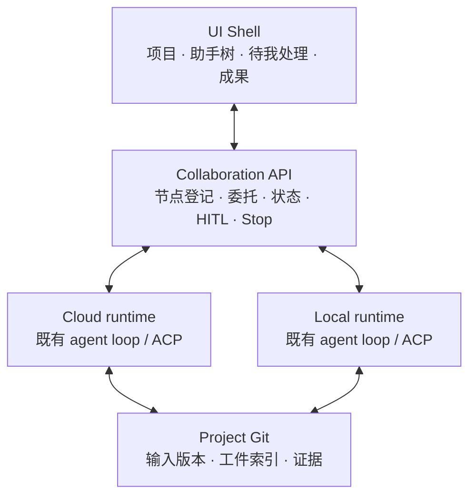
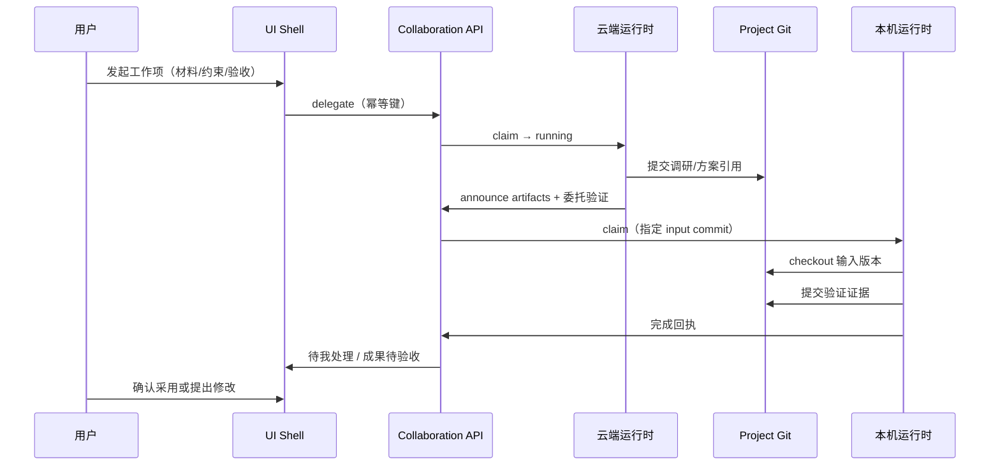

# CodeG「通用 Agent 调度底座 × 数字员工 × 多项目编队」正式方案

| 字段 | 内容 |
|------|------|
| **日期** | 2026-10-14（Asia/Manila） |
| **状态** | 正式方案草案（可供工程/产品拆里程碑；**未声称已实现**） |
| **读者** | Mack、产品、工程 |
| **对内定位** | 个人 FDE（Forward Deployed Engineer）多智能体工作台 |
| **主推架构** | **Option A**：协作层叠在现有云端 + 本机双运行时上 |
| **对照路径** | Option B（以 DSH/Cordis 置换底座）仅作对照与否决/spike 理由，**不作首期换栈** |
| **OSS 对标附录** | [`oss-benchmark.md`](oss-benchmark.md)（2026-10-15；**不改 Option A**） |


## 0. 关键立场摘要（先读）

| 主题 | 立场 |
|------|------|
| 编排 | **默认 Delegate（主助手保留合成权）**；Handoff 仅明确分流 |
| 跨端 | Git = 材料/工件版本引用；API = 委托/状态/介入；**首期一云一端** |
| 隔离 | 每 attempt 独立 worktree/工作目录 + 独立会话日志；能力令牌 = manifest ∩ 节点能力 ∩ 用户授权；**禁止共享可写活动目录** |
| 无 Git | 交付目录 + hash 可验收；不强制 worktree |
| 指令 | 送达语义：立即 / 下一轮读取 / 队列；Stop 带范围并等节点回执 |
| 验收 | 子任务完成 ≠ 主项业务验收；「确认采用」≠ Git merge |

**五条产品赌注**（OSS 证据 + mockup；详 [`oss-benchmark.md`](oss-benchmark.md) §3）：

| # | 赌注 | 一句话 |
|---|------|--------|
| 1 | 项目一等公民 | Project = 约束 + 资料 + 编队 + 默认节点；≠ 侧栏 folder |
| 2 | 默认 Delegate | 主助手保留合成权；Handoff 仅明确分流 |
| 3 | HITL 分轨且绑本次运行 | 提问 / 权限 / 验收三分；一律绑 `execution_attempt_id` |
| 4 | attempt 级隔离 + 跨端版本引用 | 禁共享可写活动目录；跨端靠版本引用不搬进程 |
| 5 | 固定壳先于开放生成 UI | G0→G1；G2 慎用；HITL/验收永不走开放 HTML |

**界面与旅程专章：** 分区线框、用户旅程、操作示意见同目录 [`ui-journeys.md`](ui-journeys.md)（补 §10 可视设计层）。  
**开源对标附录：** 行业方向、相关度排名、Must-cover 八维、Copy/Adapt/Avoid 见 [`oss-benchmark.md`](oss-benchmark.md)（主文仍以 Option A 为主；附录**不**推倒换栈）。
**OSS 开放问题：** **O1–O4 已拍板**（2026-10-15），见 §15「已决议」。

下文各章先给结论再展开；Option A 为主路径，Option B 仅对照。

---

## 1. 背景与问题

**结论：** CodeG 应从「强 coding agent 工作台」演进为 **以项目为容器、以数字员工为可装配角色、以通用调度底座做委托/隔离/HITL/触发** 的个人多智能体工作台；云端与本机对等执行，人通过「待我处理」与「成果验收」深度参与。

### 1.1 问题陈述

当前 CodeG 具备 ACP 会话、To-do、Automation、worktree、频道入站与双运行时（桌面 / server）等能力，但产品对象仍偏「会话 + 任务工具」，缺少：

1. 与业务无关的 **通用 Agent 调度底座**（节点、委托、幂等、HITL 门、触发、工件版本）；
2. 可复用、可按项目装配的 **数字员工** 包边界；
3. 一等公民的 **项目** 上下文（约束、资料、编队、默认执行位置）；
4. 跨端协作的 **Git + API 契约** 与防双跑语义；
5. 与 mockup 对齐的 **待我处理三态** 与成果验收闭环。

### 1.2 与原稿 PRD / 评审的差异

| 来源 | 主张 | 本方案立场 |
|------|------|------------|
| 原稿 PRD（`codeg-personal-work-prd-2026-10-14`） | 「个人工作代理台」、非开发者文案优先、开 Git 才露多代理 | **不采纳**该定位；多代理与 FDE 连续工作链为核心 |
| PRD 评审（`review.md`） | 个人 FDE 多智能体；补交接/证据/项目上下文；勿伪造非 Git 隔离 | **继承**评审验收故事与边界判断 |
| 云/端提案（`cloud-local/proposal.md`） | 两端完整运行时 + 轻量协作 API；Git 管材料，API 管委托/状态/介入 | **吸收为底座主线** |
| Mockups（四张工作台稿） | 项目容器、主/子助手、云端\|此电脑、待我处理三态、成果与证据 | **UI 为 IA 基线**，映射到对象模型 |

### 1.3 七层目标（全文必须覆盖）

| # | 目标层 | 本方案对应章节 |
|---|--------|----------------|
| 1 | 通用 Agent 调度底座（Substrate） | §3、§4 |
| 2 | 数字员工（Digital Employee） | §5 |
| 3 | 项目（Project）容器与编队 | §6 |
| 4 | 工作 / 交接 / 协作 / 隔离 | §7 |
| 5 | 人在环（HITL） | §8 |
| 6 | 自动触发 | §9 |
| 7 | 易交互 + 易扩展 UI（含 AG-UI / A2UI；参考 DSH） | §10、§11 |


### 1.4 原稿承诺 → 本方案处置

| 原稿倾向 | 本方案处置 |
|----------|------------|
| 非开发者办公文案优先 | **删除**为默认叙事；对内 FDE |
| 开 Git 才露多代理 | **删除**；多代理核心可达 |
| 消息转任务仅 text+folder | **补齐**交接 payload（§7.1） |
| 非 Git「隔离后采纳」当文案层 | **不承诺**全量复制隔离；报告类走交付目录+hash |
| 待你确认混权限与验收 | **分轨**提问/权限/验收（§8） |
| 进度条随意 N/M | 仅在确有阶段列表时显示；否则最近进展+阻塞原因 |
| 云协作后置 | **上调**为一云一端首期核心（§3、§7、§12） |


---

## 2. 术语表

**结论：** 下列对象边界固定；禁止用「都是 agent」糊弄分层。

| 术语（中英） | 定义 |
|--------------|------|
| **Substrate / 调度底座** | 与业务无关的运行与协作层：会话/任务生命周期、委托、幂等、节点注册、事件、HITL 门、触发器、工件版本引用。不承载具体业务话术。 |
| **Digital Employee / 数字员工** | 可加载的角色封装：场景能力 + Skills + Tools + Memory 策略 + HITL/触发白名单 + UI 表面声明。**不是**单次 run；可跨多次执行尝试复用。 |
| **Project / 项目** | 一个人的工作领域容器：约束、资料索引、员工编队、默认执行位置、Work items。侧栏 folder group **不等于**项目共享上下文。 |
| **Work item / 工作项** | 项目内可并行的主任务单元（需求与方案 / 接口验证 / 交付材料等）。有负责方；可挂多条子任务。 |
| **Execution attempt / 执行尝试** | 某工作项（或子任务）在某一节点上的一次具体运行。HITL、补充指令、停止、成果回执均绑定本次运行。 |
| **Node / 节点** | 执行位置：`cloud`（云端）或 `local`（此电脑）。**身份 ≠ 节点**：同一「主助手」可在云端跑，验证助手可在此电脑跑。 |
| **Artifact / 工件** | 版本化交付物（文档、代码、表格、证据清单等）。有版本号 / commit / hash。 |
| **Evidence / 证据** | 与工件关联的验证依据、来源引用、协作记录（谁在哪端跑）。 |
| **Handoff / 交棒** | 接收方接手主对话控制权。仅用于明确分流场景。 |
| **Delegate / 委托** | 主助手保留合成权，子员工交回工件与摘要。**默认编排模式。** |

---

## 3. 目标架构总图

**结论：** 首期锁定 **Option A**。Option B 仅作对照，不作为换栈计划。

### 3.1 Option A（主推）— 协作层叠现有双运行时



**对象叠层：**

| 层 | 组成 |
|----|------|
| Digital Employee | Manifest（skills / tools / memory / isolation / hitl / triggers / ui_surfaces / default_node_prefs） |
| Project | Context（constraints + materials + roster + defaults）+ Work items |
| Substrate | Collaboration API + 两端既有运行时 + 事件 / 幂等 / HITL 门 |

**优点：** 对齐 cloud-local 提案与 mockups；复用 CodeG 双运行时；个人 FDE 闭环可首期验收；UI 不推倒。  
**代价：** 需做跨节点 id 映射、幂等认领、Git/API 一致性；数字员工 manifest 为新模型。

### 3.2 Option B（对照）— 以 DSH/Cordis 置换底座

把调度 / 插件 / 会话日志迁到 DeepSeek Harness（Cordis），CodeG UI 变客户端。

| 优点 | 否决 / 后置理由 |
|------|-----------------|
| 插件生态与 webhook 现成；ACP profile 可能缩短协议距离 | **重写成本高**；与现有 To-do / worktree / 频道深度绑定冲突；个人 FDE 云本地 Git 协作仍要自建；团队学习 Cordis 风险集中 |

**立场：** 借鉴 DSH 思想（plugin/profile、session log、webhook、control room），**首期不换 Cordis**。若未来评估置换，单列可行性 spike，不进首期里程碑。

### 3.3 横切硬约束（A/B 均适用，本方案按 A 落实）

1. 默认编排：**主助手 Delegate**；Handoff 仅明确分流。
2. 跨端：Git 管材料/工件版本引用；API 管委托/状态/介入；首期一云一端。
3. 隔离：每 execution attempt 独立 worktree/工作目录 + 独立会话日志；能力令牌 = 员工 manifest ∩ 节点能力 ∩ 用户授权。
4. 禁止共享可写活动目录；共享只读项目约束与材料索引。
5. 交付目录 + hash 可作为无 Git 报告类项目的验收方式（不强制 worktree）。
6. 子任务完成 ≠ 主项业务验收；「确认采用」≠ Git merge。

---

## 4. 底座能力清单（Substrate）

**结论：** 底座提供接口级/对象级能力，供工程拆任务；字段可后续定稿，语义不可含糊。

### 4.1 能力总表

| 能力域 | 对象 / 接口级职责 | 首期最低要求 |
|--------|-------------------|--------------|
| **生命周期** | Work item ↔ Execution attempt 状态机：`queued → claimed → running → awaiting_* → completed / failed / stopped` | 每次尝试可审计；状态不可静默跳代 |
| **委托 Delegate** | `delegate(request)`：目标、验收标准、材料引用、项目 ID、输入 commit、工具需求、幂等键、负责员工、目标节点偏好 | 主助手保留合成权；子任务独立卡片 |
| **幂等** | 稳定 `idempotency_key`；接收节点持久化认领并回执 | 网络重试先查状态，不重复执行已认领请求 |
| **节点注册** | Node：`id, kind(cloud\|local), online, capabilities[], grants[]` | 能力按节点声明；浏览器/电脑能力不因连上 server 而全局显示 |
| **事件** | 进度、HITL 请求、成果就绪、停止回执、同步等待 | 可先用现有 WS/ACP，再适配 AG-UI 事件 |
| **HITL 门** | 提问 / 权限 / 验收三类请求对象，均绑定 `execution_attempt_id` | 统一入口，底层类型不合并 |
| **触发器** | Trigger 安装实例 → 创建新 run（不复用旧 attempt） | 权限继承 + 防循环（§9） |
| **工件版本** | ArtifactRef：`project_id, path\|uri, commit\|hash, version_label` | API 先到而 Git 未同步时显示「等待成果同步」，不伪装完成、不自动重跑 |

### 4.2 协作 API（叠在 codeg-server 上）

首期可放在已有 codeg-server，客户端主动建立认证连接接收有范围的委托。建议接口族（名称可调）：

| 接口族 | 用途 |
|--------|------|
| `nodes.register / heartbeat / capabilities` | 节点在线与能力 |
| `projects.resolve` | 跨端稳定项目标识 → 本地路径 / clone |
| `delegate.create / claim / ack` | 委托与幂等认领 |
| `execution.status / events` | 进度与事件流 |
| `hitl.list / respond` | 待我处理 |
| `steer / stop` | 补充指令与停止（含送达语义与范围） |
| `artifacts.announce / sync_wait` | 成果引用与同步等待 |

**非目标（底座层）：** 不复制两端 SQLite；不建完整事件溯源平台；不首期做多节点全互联与强制接管。

### 4.4 关键对象草图（可拆任务，字段可迭代）

以下用伪结构说明对象边界，便于工程建表 / protobuf / JSON schema，**不是**已定稿 API。

```text
Node {
  node_id, kind: cloud|local, display_name,
  online, last_heartbeat_at,
  capabilities: [tool_or_runtime_id...],
  grants: [user_authorized_capability...]
}

ProjectRef {
  project_id,              // 跨端稳定 id
  git?: { remote_url, default_branch },
  local_roots?: { node_id → path },  // 仅节点本地解析
  wiki_bind?, constraints_ref, materials_index_ref
}

DigitalEmployeeManifest { /* 见 §5.1 */ }

WorkItem {
  work_item_id, project_id, title, owner_employee_id,
  acceptance_criteria, status
}

ExecutionAttempt {
  attempt_id, work_item_id, parent_attempt_id?,
  employee_id, node_id,
  idempotency_key, input_commit|input_hash,
  workspace_ref, session_log_ref,
  status, hitl_open_count, artifact_refs[]
}

DelegateRequest {
  ...payload §7.1...,
  created_by_attempt_id, created_at
}

HitlRequest {
  hitl_id, kind: question|permission|acceptance,
  attempt_id, project_id, work_item_id,
  employee_id, node_id, payload, created_at
}
```

**状态机要点：** `claimed` 之后同一 `idempotency_key` 不得再次进入可执行态；`awaiting_input` 与 `review` 分轨；`completed` 仅表示该 attempt 跑完，主 work item 是否业务验收见 §8。

### 4.3 与现有能力的叠法

| 现有能力 | 叠法 |
|----------|------|
| ACP / ConnectionManager 委托 | 同节点内继续用；跨节点经 Collaboration API + 引用映射 |
| To-do / WorkTask + worktree | Git 项目执行尝试默认走独立 worktree |
| Automation cron | 作为周期触发的事实来源；每次执行独立记录 |
| 频道入站 | 作为触发源之一，经权限与防循环进入新 run |
| Wiki 导入 / FilePreview | 成果预览与落点复用；不重造文档平台 |

---

## 5. 数字员工模型

**结论：** 数字员工 = **Manifest 包**，按项目编队加载；运行时由底座创建 execution attempt，而不是「员工本身等于一次进程」。

### 5.1 Manifest 字段建议

| 字段 | 含义 |
|------|------|
| `id` | 稳定标识（跨项目引用） |
| `display_name` | 界面显示名（如「调研助手」「验证助手」） |
| `scenario_tags[]` | 场景标签（调研 / 验证 / 方案复核 / 交付…） |
| `skills[]` | 可加载 Skill 引用 |
| `tools[]` | 工具白名单或工具包引用 |
| `memory_policy` | 记忆范围：`none` / `project` / `employee_global`（跨项目，需显式）/ 冲突覆盖规则 |
| `isolation_policy` | 工作目录策略：`git_worktree` / `delivery_dir` / `ephemeral_workspace` |
| `hitl_policy` | 哪些动作必须提问/权限；是否允许自动验收（默认否） |
| `trigger_allowlist` | 允许响应的触发器类型 |
| `ui_surfaces[]` | `view_id` 或 catalog surface 声明（G0/G1） |
| `default_node_prefs` | 偏好节点：`prefer_local` / `prefer_cloud` / `any`；缺工具时的降级提示 |

### 5.2 加载到项目的规则

1. 项目 `roster` 声明启用的员工 id 与角色（主助手 / 专家子员工）。
2. 加载时注入 **只读** 项目约束与材料索引；单次子任务不得静默覆盖项目约束。
3. 子员工默认 **不继承** 父员工全部密钥；能力令牌 = manifest ∩ 节点能力 ∩ 用户授权。
4. 临时子代理只需与任务相符的工具与上下文，不必等于完整长期员工。

### 5.3 记忆范围

| 层级 | 内容 | 冲突时 |
|------|------|--------|
| 用户全局偏好 | 语言、通知、默认节点 | 最低优先级于项目硬约束 |
| 员工记忆 | 可复用方法、个人工作习惯（若启用 `employee_global`） | 不得覆盖项目约束与本次验收标准 |
| 项目 Wiki / 约束 | 客户限制、成功标准、环境 | **最高优先级**（只读注入） |
| 单次 attempt 会话日志 | 本次推理与工具轨迹 | 不自动升格为项目真相 |

> 记忆边界的最终覆盖策略仍标为开放问题（§14 #8），供 Mack 拍板；上表为工程默认可实施草案。

### 5.4 工具 / 技能包装

- Skills / Tools 以引用挂到 manifest，由底座在 attempt 启动时解析。
- 节点缺少工具时：UI 展示「缺工具」并给出换节点或降级选项，不静默失败为「已完成」。
- 新员工扩展路径：新增 manifest + 可选 catalog surface，**不改壳路由**。

### 5.5 示例编队（「客户工单接入」域）

与 mockup 示例域对齐，仅作说明，不构成产品内置员工清单。

| 员工 | 典型节点偏好 | 主要产出 | 备注 |
|------|--------------|----------|------|
| 主助手（FDE 主办） | cloud 或 local（用户选） | 合成方案、委托树、验收清单 | 保留合成权；默认 Delegate |
| 调研助手 | cloud | 带出处的调研笔记 | 只读外网/资料；不写客户环境 |
| 验证助手 | local | 接口/环境验证记录与证据 | 需要本机工具或测试环境时 |
| 方案复核助手 | any | 风险与缺口清单 | 只读输入 commit；不直接改活动目录 |

加载规则补充：项目可只启用子集；未在 roster 中的员工不可被触发器静默拉起（除非用户全局安装并授权）。

---

## 6. 项目模型

**结论：** 项目是一等公民容器；Git 属性只决定 Git 功能是否可用，不决定是否露出多代理。

### 6.1 项目组成

| 组成部分 | 说明 |
|----------|------|
| **约束 Constraints** | 已确认限制、待确认项、成功标准；只读共享给编队 |
| **资料 Materials** | 需求材料、接口样本、日志、Wiki 来源；以相对路径 / 引用进入交接 |
| **编队 Roster** | 主助手 + 按需专家员工；可设项目默认主助手 |
| **默认执行位置** | 项目级默认 Node；单次工作项可覆盖 |
| **Work items** | 可并行主任务行；每行可挂委托树 |

### 6.2 与 Git / Wiki 的关系

| 场景 | 约定 |
|------|------|
| Git 项目 | 材料与工件用 commit/分支/相对路径引用；并行子任务各自分支，由负责助手汇总 |
| 无 Git 报告类项目 | 允许「交付目录 + 内容 hash」验收；**不强制** worktree；不承诺统一回滚与部分采纳回写 |
| Wiki | 项目可绑定 Wiki；「素材已导入」与「整理页已生成」区分；采纳后写入，避免执行期抢写导致打回无效 |

### 6.3 与现有 folder / 侧栏的关系

- 目录默认代理、工作目录指令、授权目录链接、Wiki 项目绑定可先组成「项目工作说明」。
- 侧栏 folder group 仅为展示分组，**不能**自动当作共享上下文。
- 完整「项目中心」实体可渐进落地，但跨端必须有稳定 `project_id`，禁止用本机绝对路径或单库数字 id 定位对端。


### 6.4 项目级默认与覆盖顺序

创建工作项或委托时，执行位置与员工选择按下列顺序解析（后者覆盖前者，但不得覆盖项目硬约束全文）：

1. 用户在 Composer / 委托面板的**显式选择**；  
2. 工作项上已保存的覆盖；  
3. 数字员工 `default_node_prefs`；  
4. 项目默认执行位置与默认主助手；  
5. 系统默认（例如当前 UI 所在节点仅作展示，不自动等于执行节点）。

界面所在窗口与任务实际执行位置必须分别显示（对齐 mockup 底栏与子任务节点标签）。


---

## 7. 协作与隔离

**结论：** 直接吸收 cloud-local 提案：Git 管版本材料，API 管委托/状态/介入；身份 ≠ 节点；防双跑与禁止共享可写目录为硬规则。

### 7.1 交接 payload（Delegate 请求最小集）

| 字段 | 用途 |
|------|------|
| `goal` / `acceptance_criteria` | 目标与完成标准 |
| `selected_materials[]` | 选定材料引用（非整库默默带走） |
| `project_id` | 稳定项目标识 |
| `input_commit` / `input_hash` | 输入版本 |
| `extra_inputs[]` | 本机未提交资料等额外输入（快照/hash 或指定持有节点处理） |
| `required_tools[]` | 工具需求 |
| `employee_id` / `role` | 执行员工 |
| `preferred_node` | 节点偏好 |
| `idempotency_key` | 防双跑 |
| `parent_work_item_id` / `parent_attempt_id` | 回流与串代防护 |
| `source_session_ref` | 来源会话链接（可追溯） |

**明确不交接：** 运行中进程状态、浏览器登录态、模型内部 KV、对端绝对路径、父员工全部密钥。

### 7.2 跨端 Git + API 分工

| 内容 | 责任 |
|------|------|
| 项目说明、约束、代码、可管理文档、结果与证据清单 | **Git** 版本；交接引用 commit / 任务分支 / 相对路径 |
| 发起/认领、进度、在线、补充指令、提问、权限、停止、完成回执 | **API**；节点本地保存运行事实 |
| 大文件 / 二进制 | 文件传输；Git 存索引与 hash |
| 密钥、应用登录态、运行 DB、全部会话历史 | 按节点与既有授权管理，**不**因共享仓库自动同步 |

**同步语义：** 通常先确认输入版本可取得再执行；产出提交成功后回传引用。若 API 消息先到、Git 内容尚不可读 → UI「等待成果同步」，**不**当执行失败自动重跑。

### 7.3 防双跑与断线

| 规则 | 语义 |
|------|------|
| 认领 | 同一 `idempotency_key` 仅一个节点成功 claim |
| 重试 | 先查询状态再决定是否新建 attempt |
| 断线 | 已领取任务按原授权继续；依赖离线节点的步骤明确等待；**不因心跳超时自动重派** |
| 转移 | 旧 attempt 停止并确认后，才从检查点启动新 attempt；源节点不可达时保留待核对；首期 **无强制接管** |
| 外部写 | 委托去重不自动保证第三方操作只发生一次；结果未知时先核对 |

### 7.4 隔离不变量

1. 每 execution attempt：**独立** worktree 或工作目录 + **独立**会话日志。
2. **禁止**共享可写活动目录；消息总线只传引用。
3. 共享：**只读**项目约束与材料索引。
4. 能力令牌 = 员工 manifest ∩ 节点能力 ∩ 用户授权。
5. 主任务验收与子任务完成分开记账；分支合并成功 ≠ 业务验收通过。

### 7.5 补充指令送达语义

| 模式 | 含义 |
|------|------|
| **立即** | 尝试打断当前回合（仅当运行时支持 steering） |
| **下一轮读取** | 不打断当前 turn；代理下一轮消费（对齐 mockup） |
| **队列** | 进入后续消息队列，按序消费 |

发送后需节点回执（已送达 / 已入队 / 不支持）。补充指令必须绑定选中的子任务与 `execution_attempt_id`，防止串代。


### 7.6 一云一端主路径时序（逻辑）



若 `L` 离线：云端独立支线可完成；验证步显示等待本机，**不**自动改派到云端伪装「已验证」。


---

## 8. HITL（人在环）

**结论：** 对齐 mockup「待我处理」三态；统一入口、底层分轨；一律绑定本次运行；Stop 必须带范围并等回执。

### 8.1 三态（不可合并）

| UI Tab | 底层语义 | 用户动作后果 |
|--------|----------|--------------|
| **提问** | `awaiting_input`（澄清类） | 回答进入该 attempt 上下文，继续执行 |
| **权限** | `awaiting_input`（授权类） | 授予/拒绝具体操作能力；**不**等于整任务验收 |
| **验收** | `review`（成果类） | 「提出修改」或「确认采用」；确认采用 = **业务验收**，≠ Git merge / 发布 / 部署 |

> 现有任务状态已区分 `awaiting_input` 与 `review`。看板可聚合「待我处理」，**禁止**为简化而合并底层含义。

### 8.2 绑定与延迟

每条 HITL 请求展示并持久化：`project_id` / `work_item_id` / `employee_id` / `node_id` / **`execution_attempt_id`**。  
允许「稍后处理」；回复不得落到错误代次。

### 8.3 停止范围

| 范围 | 效果 |
|------|------|
| 仅当前执行 | 停止该 attempt |
| 整工作项 | 停止该 work item 下所有活跃子 attempt |
| 不含定时 | 定时/Automation 计划单独管理，不被「停止工作项」误杀 |

发送后等待各节点回执；未连上节点显示「尚未确认」，**不**在回执前抢占执行。

### 8.4 人的参与点（全链路）

1. **发起**：选资料、约束、验收条件、运行位置。  
2. **运行中**：steer / queue / stop（按代理能力显示）。  
3. **门禁**：提问 / 权限。  
4. **验收**：预览 → 提出修改 / 确认采用；区分已生成、已验证、已保存、已发布。

**不做：** 强制凡写文件先出计划卡、全代理统一三档审批（后置并按代理验证映射）。

### 8.5 易混淆操作对照

| 操作 | 是什么 | 不是什么 |
|------|--------|----------|
| 复制任务/会话 | 产生**新** attempt，不抢走原执行权 | 不是故障接管 |
| 停止后重新委派 | 旧 attempt 停止确认后，基于检查点开新 attempt | 不是心跳超时自动重派 |
| 确认采用 | 业务验收通过，可触发保存/导入等落点策略 | 不是 Git merge，也不是发布/部署 |
| 批准计划（若启用） | 同意某次计划文本 | 不等于本任务内所有写操作已预授权 |
| 权限允许 | 授予具体工具/路径操作 | 不等于成果验收 |

---

## 9. 触发器

**结论：** 复用 Automation + 频道为事实来源；每次触发创建独立 run；权限继承与防循环为硬要求。

### 9.1 触发源分层

| 阶段 | 来源 | 说明 |
|------|------|------|
| 首期 | Automation / cron | 周期事实来源；明确「仅生成待办」vs「到点执行」 |
| 首期 | 频道入站 | 飞书 / 微信 / Telegram 等既有入站 → 新 run 或续会话（策略显式） |
| 后期 | Webhook / connector | 邮件、日历、GitHub 等；模式可借鉴 DSH webhook → session |

### 9.2 权限继承

- 触发器挂在 **项目** 或 **员工安装实例** 上。
- 触发产生的 run 继承：项目约束 + 员工 manifest 能力 ∩ 触发器安装时的用户授权。
- Maker / 安装者权限与运行时节点能力同时校验（参考 Copilot Studio / Glean 公开模式，不照搬企业套件）。

### 9.3 防循环

1. 触发器配置排除「本系统 Bot / 本 Automation 自己写出的事件」。  
2. 同一外部事件 id 幂等，不重复开跑。  
3. 员工 A 的产出默认不自动触发员工 A 的同类型触发器，除非显式允许并设深度上限。  
4. 每次执行留下独立结果记录；宿主离线或阻塞时 UI/提醒反映真实状态，不假装已跑。

---

## 10. UI 与扩展

**结论：** 以四张 mockup 为 IA 基线；G0 → G1 → G2 分阶段；AG-UI 作事件适配，不重做导航；HITL/验收永远走 G0/G1。

> **详细草图 / 旅程 / 操作示意：** 见同目录专章 [`ui-journeys.md`](ui-journeys.md)（ASCII/mermaid 线框、Journey A–C、逐步 Task flows、对象对照与可视化验收清单）。本节仅保留 IA 基线表与扩展策略；**不**在此重复线框正文。

### 10.1 IA 基线（四张 mockup）

| 稿 | 产品落点 | 概念稿 |
|----|----------|--------|
| 01 项目工作台 | 项目列表、工作行、主/子助手、待我处理、最新成果、项目约束、底栏节点在线 | [见图](../codeg-personal-workbench-mockups-2026-10-14/01-project-workbench.png) · [线框](ui-journeys.md#11-屏-01--项目工作台) |
| 02 多 Agent 协作 | 委托树、子任务日志与产出、补充指令（下一轮读取）、跨端版本时间线、Stop 范围 | [见图](../codeg-personal-workbench-mockups-2026-10-14/02-multi-agent-collaboration-v2.png) · [线框](ui-journeys.md#12-屏-02--多-agent-协作) |
| 03 待我处理 | Tab：全部 / 提问 / 权限 / 验收；详情绑定项目/工作项/助手/节点/**本次运行** | [见图](../codeg-personal-workbench-mockups-2026-10-14/03-human-intervention-v2.png) · [线框](ui-journeys.md#13-屏-03--待我处理) |
| 04 成果与证据 | 工件版本、Preview/Changes/Source、提出修改/确认采用、证据与协作记录 | [见图](../codeg-personal-workbench-mockups-2026-10-14/04-artifacts-and-evidence.png) · [线框](ui-journeys.md#14-屏-04--成果与证据) |

视觉约定（实现时可参考）：浅色桌面、蓝主动作、青绿运行、琥珀待处理。分区线框与未画全状态（离线重连 / 等待 Git 同步 / Stop 确认）见 [`ui-journeys.md` §1](ui-journeys.md#1-界面设计草图wireframes)。

### 10.2 生成式 UI 三阶段

| 阶段 | 做法 | 适用 |
|------|------|------|
| **G0 固定壳（首期）** | 员工/项目声明 `view_id`；壳渲染固定组件（工作台、待我处理、成果、计划卡…） | 全部主路径 |
| **G1 A2UI Catalog** | 平台维护组件目录；员工填 data model / 选模板 | 扩展员工表面；仍受控 |
| **G2 Dynamic 慎用** | 二次 LLM 生成组件树 | 仅只读仪表盘/配置向导试点；**白名单校验** |

**硬规则：** 提问 / 权限 / 验收与成果验收 **永远走 G0/G1**。开放 HTML/任意布局生成 UI **非目标**。

### 10.3 AG-UI 定位

| AG-UI 是 | AG-UI 不是 |
|----------|------------|
| Agent↔User 双向事件流协议（文本、工具、状态、subagent、interrupt…） | 「Agent 随便画任意 HTML」 |
| 标准化「运行事件 → UI」适配层，便于多端 | 调度引擎本身 |
| 未来员工可选表面的挂载点 | 重做导航或替代 mockup IA |

A2UI（createSurface / updateComponents / updateDataModel）挂在 AG-UI 活动事件上；与 MCP（工具）、未来 A2A（员工间）分层共存。

### 10.4 首期需补的状态（mockup 未画全）

离线重连、缺工具、停止确认、文件同步失败、幂等双跑防护提示、成果「等待 Git 同步」、节点能力不足时的降级选择。

其中 **离线重连 / 等待 Git 同步 / Stop 范围确认** 已在 [`ui-journeys.md` §1.5](ui-journeys.md#15-补全状态草图概念稿未画全) 给线框示意；其余状态在实现时按同一信息架构补齐。

---

## 11. 开源对标（摘要）

**结论：** 高星个人工作台 OSS 证据**强化** Option A（协作层叠双运行时），**不**支持首期换 Cordis / 做成企业 Den / 用「接尽 CLI」替代数字员工。详细对照见附录 [`oss-benchmark.md`](oss-benchmark.md)。

### 11.1 相关度顺序与星数快照（2026-10-15）

| 秩 | 仓库 | ★约 | 许可要点 | CodeG 主要用法 |
|----|------|-----|----------|----------------|
| 1 | cc-haha | 15.0k | MIT | Teams / worktree / 权限档 / `agents/*.md`（同构最高） |
| 2 | Kun | 6.3k | **PolyForm Noncommercial** | 审批 API、delegate 降权、证据三分离（架构参考） |
| 3 | Eigent | 15.5k | Apache-2.0 | Space→Session→Task；Workforce；HumanToolkit |
| 4 | OpenWork | 24.1k | **MIT 核心 + `ee/` 另议** | Ask/Allow/Block；能力 MCP Gateway |
| 5 | OpenAgents | 4.2k | Apache-2.0 | 跨机汇合面；**勿**写成员工模型 |
| 对照 | OpenHands / Goose / Cline / Continue / DSH | 90.9k / 55.3k / 70.3k / 36.2k / 249.8k | 见附录 | 多后端 UX、MCP、IDE 流畅度、plugin 思想；**DSH 不换栈** |

### 11.2 Must-cover → CodeG 立场（八维压缩）

| # | 主题 | CodeG 立场 |
|---|------|------------|
| 1 | 项目容器 | Project 一等公民（约束/资料/编队/默认节点） |
| 2 | 数字员工 | 场景+Skills+Tools+Memory+HITL 白名单；可按项目加载 |
| 3 | 编排 | **默认 Delegate**；Handoff 仅分流 |
| 4 | HITL | **提问/权限/验收三分**；绑 attempt |
| 5 | 隔离 | attempt 级；禁共享可写活动目录 |
| 6 | 双运行时 | 云端\|此电脑；Git=材料，API=委托/状态/介入 |
| 7 | 成果证据 | Preview+版本+验证；**确认采用 ≠ merge**（OSS 验收普遍弱——保持领先） |
| 8 | UI | G0→G1；G2 慎用 |

**Copy / Adapt / Avoid** 一页与分仓卡片见附录 §6–§7。对 Option A 的含义见附录 §8：**胜出靠 IA+HITL+隔离+可装配，不靠统一 harness。**

### 11.3 与本方案章节的接线

| 附录主题 | 主文落点 |
|----------|----------|
| 五条赌注 | §0 |
| 项目 / 员工 / Delegate | §5、§6、§7 |
| HITL 三分与验收 | §8、§13 |
| 隔离与双运行时 | §3、§7 |
| 固定壳 G0→G1 | §10 |
| DSH 只学思想 | §12 |
| OSS O1–O4（**已拍板**） | §15「已决议（2026-10-15）」 |

---

## 12. DSH 借鉴清单

**结论：** 学思想、借模式；**明确不首期换栈**：不以 Cordis / DSH 置换 CodeG 现有运行时。

### 12.1 借鉴

| 借鉴点 | 落到 CodeG |
|--------|------------|
| Everything-is-plugin / profile 组合 | 数字员工 manifest + 底座能力缝；profile 式启动组合可后置 |
| Session append-only log 为真相 | 每 attempt 独立会话日志；模型可见内容可重建；支撑成果与证据 |
| Webhook → 新 session/run | 后期触发器形态 |
| Control room「needs you」聚合 | 「待我处理」信息架构 |
| Steer / Ultra Slash 不打断当前 turn | 「下一轮读取」送达语义 |
| Capability seams | 节点能力声明与可替换执行世界（思想对齐） |
| 社区 Workbench / Worktable | IA 参考（三栏、control room 卡片）；**非**官方唯一 UI，勿当成 DeepSeek 产品本体 |

### 12.2 明确不做（首期）

- 将 CodeG 运行时重写为 Cordis。  
- 把社区插件 UI 当作官方 DSH 产品规格照搬。  
- 在未做 spike 前承诺与 DSH ACP「字节级兼容」。

### 12.3 可选 spike（非首期门禁）

若 Mack 批准：单列「DSH ACP profile 互通 / session log 形态对照」spike；输出可行性与成本，再决定是否进入后续里程碑。

---

## 13. 首期验收故事

**结论：** 复用评审七条 + cloud-local 一云一端闭环；另列可靠性验收。以下均为**目标验收**，非声称现状已具备。

### 13.1 FDE 协作七条（来自 review）

1. 客户需求材料交给主办，必要时并行委派调研、代码/接口调查与方案审阅；结果保留来源，回到同一项目。  
2. 讨论后任务转交另一代理，选定附件、客户约束、工作目录与验收条件保持一致；用户能从原会话找到执行与成果。  
3. 同一项目内连续完成需求澄清、方案文档、PoC 代码与验证记录，**无需**按 Git 属性切换能力集合。  
4. 现场问题：依据日志与环境提出可验证假设，执行被授权检查，交付修复证据与未决事项。  
5. 方案/报告可预览、修改、明确保存到目标位置并在后续任务引用；「已生成 / 已验证 / 已保存 / 已发布」不混为一次回合完成。  
6. 项目资料与通用方法分开沉淀；项目切换时材料引用与目标环境保持明确。  
7. 周期任务到点实际执行并留独立结果；宿主离线或阻塞时界面与提醒反映真实状态。

### 13.2 一云一端闭环（来自 cloud-local）

1. 用户从客户需求材料发起，保留目标、约束、来源与验收条件。  
2. 云端助手按需启动调研与方案子代理，把引用和方案提交到任务分支。  
3. 客户端助手读取指定版本，结合本地资料/代码/测试环境验证；需要时再调本地子代理。  
4. 验证结果与证据按共享范围提交或上传，回传负责助手汇总。  
5. 用户在同一工作项中查看进度、回答问题、修改方向，并审阅最终文档/代码及验证记录。

### 13.3 可靠性补充验收

| # | 故事 |
|---|------|
| R1 | 重复委托请求只启动一次（幂等认领）。 |
| R2 | 客户端断线时，云端独立支线仍可完成；依赖本机的步骤正确等待。 |
| R3 | 补充意见不会送错执行代次。 |
| R4 | 成果引用尚未同步时 **不**伪装完成、**不**自动重跑。 |
| R5 | 停止回执未收到时 **不**抢占执行。 |
| R6 | 报告类工作无需为进入成果视图先创建 Git worktree（交付目录 + hash 可验收）。 |
| R7 | 子任务完成只回填卡片；主项须经「确认采用」才算业务验收。 |

---

## 14. 里程碑与非目标

### 14.1 建议里程碑（可拆任务）

| 里程碑 | 交付 | 依赖 |
|--------|------|------|
| **M0 对象与契约** | 术语冻结；Project / Employee manifest / Attempt 数据模型；交接 payload schema | 无 |
| **M1 协作 API（一云一端）** | 节点注册、delegate/claim/ack、状态事件、幂等 | M0；codeg-server |
| **M2 项目工作台壳（G0）** | 对齐 mockup 01/02：项目、编队、委托树、节点标签、跨端版本时间线 | M0–M1 |
| **M3 HITL + 成果** | 待我处理三态；成果预览/确认采用；绑定 attempt；Stop 范围与回执 | M1–M2 |
| **M4 触发器接通** | Automation 到点执行选项 + 独立结果；频道入站防循环 | M1 |
| **M5 隔离加固** | attempt 级目录/日志；能力令牌；无 Git 交付目录路径 | M1 |
| **M6 UI 扩展预留** | AG-UI 事件适配层；A2UI catalog 设计稿（实现可并行评估） | M2–M3 |

完整首页/导航重做、多节点全互联、企业级触发器矩阵 **不**阻塞 M1–M5。

### 14.2 非目标（首期明确不做）

| 非目标 | 理由 |
|--------|------|
| 企业 SSO / 组织治理为主轴 | 个人 FDE 工作台优先 |
| 全量非 Git 目录复制隔离 + 部分采纳 + 统一回滚 | 新的文件变更机制；有真实需求再专项设计 |
| 开放 HTML / Dynamic 生成 UI 作为权限与验收主路径 | 越权与审计风险 |
| 首期多节点全互联、自动故障接管、强制接管 | 防双跑与复杂度；先打通一云一端 |
| 以 DSH/Cordis 置换现有运行时 | 见 §3.2 / §12 |
| 隐藏多代理直至打开 Git | 与定位冲突；已否决 |
| 全代理统一三档审批、凡写必先计划卡 | 代理能力差异大；增加打断 |
| 重新开发预览、调度、代理循环 | 已有底座，重点是接线与约定 |

---


### 14.3 工程拆分提示（供排期，非排期承诺）

| 工作包 | 主要章节 | 说明 |
|--------|----------|------|
| 数据模型与迁移 | §2、§4.4、§5、§6 | Project / Manifest / Attempt 表或等价存储 |
| 协作 API 与节点 | §4、§7 | 可先 HTTP+WS；事件后续适配 AG-UI |
| 同节点委托增强 | §5、§7 | 复用 ACP 子会话卡；补齐交接 payload |
| 跨端 Git 核对 | §7、§13 | sync_wait、版本时间线 |
| HITL 聚合视图 | §8、§10 | 三态分轨；绑定 attempt |
| 成果审阅接线 | §8、§13 | FilePreview + 确认采用落点 |
| Automation/频道 | §9 | 到点执行选项、防循环 |
| G0 壳对齐 mockup | §10 | 不先做导航重做 |

## 15. 开放问题

转述调研 brief §7，并标注决策归属。

| # | 问题 | 建议默认（供拍板） | 需 Mack 拍板 |
|---|------|-------------------|:------------:|
| 1 | 数字员工生命周期：长期同事 vs 项目编队角色 vs 两者分层？ | **分层**：编队角色默认；`employee_global` 记忆显式开启 | ✅ |
| 2 | 默认编排是否确认主助手委托制？交棒仅明确分流？ | **是**（本方案已按此写入） | ✅ 确认即可 |
| 3 | 首期是否锁定「一云一端」再扩展多节点？ | **是** | ✅ |
| 4 | 无 Git 纯文档项目是否允许「交付目录 + hash」验收？ | **允许**（本方案已写入） | ✅ 确认即可 |
| 5 | Ag-UI：首期只做事件适配，还是同步 A2UI catalog MVP？ | 首期 **事件适配**；catalog 进 M6 设计 | ✅ |
| 6 | 与 DSH 关系：思想借鉴 / ACP spike / 不考虑置换？ | **思想借鉴**；spike 可选、非门禁 | ✅ |
| 7 | 触发器优先级：先 Automation+频道，还是并行邮件/日历/GitHub webhook？ | 先 **Automation+频道** | ✅ |
| 8 | 记忆边界冲突时谁覆盖？ | 项目约束 > 本次验收标准 > 员工记忆 > 全局偏好 | ✅ |
| 9 | 停止是否必须选范围（当前执行 / 整工作项 / 不含定时）？ | **必须**（本方案已写入） | ✅ 确认即可 |
| 10 | 对外文案「个人工作代理台」vs 对内 FDE 多智能体如何统一？ | **对内**本方案用语；对外可保留「个人多智能体工作台」，去掉「非开发者优先 / 开 Git 才露多代理」 | ✅ |

**OSS 对标追加**（来自 [`oss-benchmark.md`](oss-benchmark.md) §9 / research handoff §7；**不删**上表原有问题）：

| # | 问题 | 决议（与建议默认一致） | 状态 |
|---|------|------------------------|------|
| O1 | 数字员工事实源：偏 cc-haha/Kun 的 Markdown manifest，还是 Eigent 式 UI 配置 + 导出？ | **Markdown/manifest 为事实源**；UI 为编辑器，导出回写 manifest | **已拍板** |
| O2 | 组织级权限策略（OpenWork 型）是否进入个人产品首期，还是仅节点本地档位？ | 首期 **仅节点本地权限档位**；组织级策略后置 | **已拍板** |
| O3 | OpenAgents 式「持久汇合 URL」与「一云一端」是否要显式产品化第三种「只读聚合视图」？ | 首期 **不做**；后期可选 | **已拍板** |
| O4 | Computer Use（cc-haha/Kun）是否进数字员工工具白名单首期？ | **可选能力、默认关**；须节点能力声明 + 用户对本 attempt 授权 | **已拍板** |

### 已决议（2026-10-15）

Mack 拍板 O1–O4，**全部按建议**；**Option A 不变**。语义如下（一字不改）：

1. **O1：** Markdown/manifest 为数字员工事实源；UI 为编辑器，导出回写 manifest  
2. **O2：** 首期仅节点本地权限档位；组织级策略后置  
3. **O3：** 首期不做 OpenAgents 式「只读聚合视图」；后期可选  
4. **O4：** Computer Use 为可选能力、默认关；须节点能力声明 + 用户对本 attempt 授权  

细节与风险说明见 [`oss-benchmark.md`](oss-benchmark.md) §9。

---

## 参考来源

### 本方案包附录

- [开源对标附录（OSS benchmark）](oss-benchmark.md) — 2026-10-15；五条赌注、八维 Must-cover、Copy/Adapt/Avoid

### OSS 工作台调研包（2026-10-15）

- [交接 → 方案撰写](/workspace/research/codeg-personal-workbench-oss-2026-10-15/handoff-to-方案撰写.md)
- [Research Brief](/workspace/research/codeg-personal-workbench-oss-2026-10-15/research-brief.md)
- [OSS Matrix](/workspace/research/codeg-personal-workbench-oss-2026-10-15/oss-matrix.md)
- [Sources（星数快照）](/workspace/research/codeg-personal-workbench-oss-2026-10-15/sources.md)

### 前次底座 / AG-UI / DSH 调研包

- [交接包 → 方案撰写](/workspace/research/codeg-agent-substrate-digital-employees-2026-10-14/handoff-to-方案撰写.md)
- [Research Brief](/workspace/research/codeg-agent-substrate-digital-employees-2026-10-14/research-brief.md)
- [Sources](/workspace/research/codeg-agent-substrate-digital-employees-2026-10-14/sources.md)

### 本地产品材料

- [界面与旅程专章（本方案包）](ui-journeys.md)
- [工作台 Mockups README](/workspace/docs/codeg-personal-workbench-mockups-2026-10-14/README.md)
- [工作台概念稿 01–04（PNG）](/workspace/docs/codeg-personal-workbench-mockups-2026-10-14/)
- [PRD 评审](/workspace/docs/codeg-personal-work-prd-review-2026-10-14/review.md)
- [云端与客户端协作建议](/workspace/docs/codeg-personal-work-prd-review-2026-10-14/cloud-local/proposal.md)
- [原稿 PRD（历史对照，勿原样开工）](/workspace/docs/codeg-personal-work-prd-2026-10-14/product-spec.md)

### 外部协议与 harness（调研已核对入口）

- [AG-UI 介绍](https://docs.copilotkit.ai/ag-ui/introduction)
- [AG-UI 1.0](https://www.copilotkit.ai/blog/ag-ui-1.0)
- [A2UI](https://docs.copilotkit.ai/agent-spec/generative-ui/a2ui)
- [DeepSeek Harness 仓库](https://github.com/deepseek-ai/deepseek-harness)
- [DSH 架构参考](https://deepseek-harness.github.io/deepseek-harness/en/reference/)
- [LangGraph handoffs](https://docs.langchain.com/oss/python/langchain/multi-agent/handoffs)
- [LangGraph interrupts](https://docs.langchain.com/oss/python/langgraph/interrupts)
- [OpenAI Agents handoffs](https://openai.github.io/openai-agents-python/handoffs/)
- [Copilot Studio triggers](https://learn.microsoft.com/en-us/microsoft-copilot-studio/authoring-triggers-about)
- [Glean content triggers](https://docs.glean.com/agents/concepts/content-trigger)

### 说明

- 本文不编造价格或未证实采用率数字；OSS 星数引用带日期 **2026-10-15**（见附录与 research pack）。  
- 未改动 `/workspace/research/...` 调研原文，未改 mockups / review / 原稿 PRD。  
- 开源对标**强化 Option A**，不因 DSH ★ 高换栈，不声称 OSS 已有同等「确认采用」。  
- 文中「可复用现有能力」指调研/评审已指出的方向，**不**表示本方案作者已重新跑通端到端或构建验证。

---

*文档结束。*
