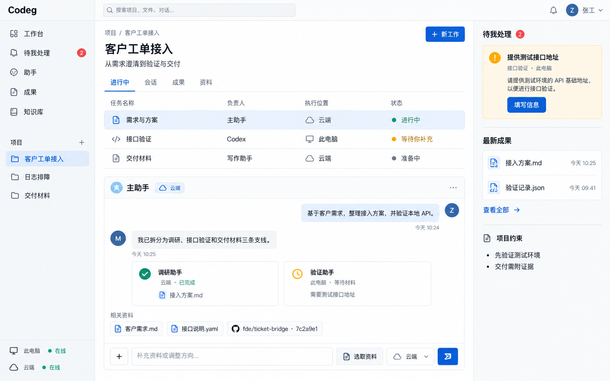
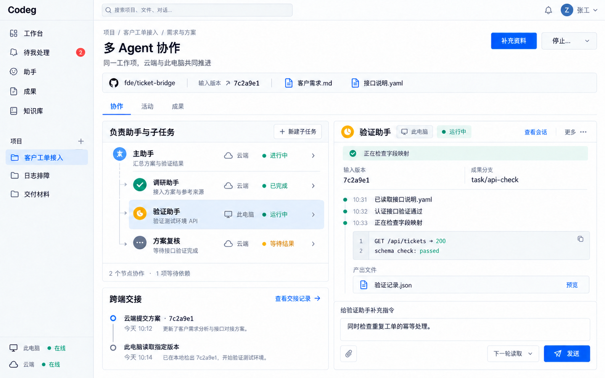
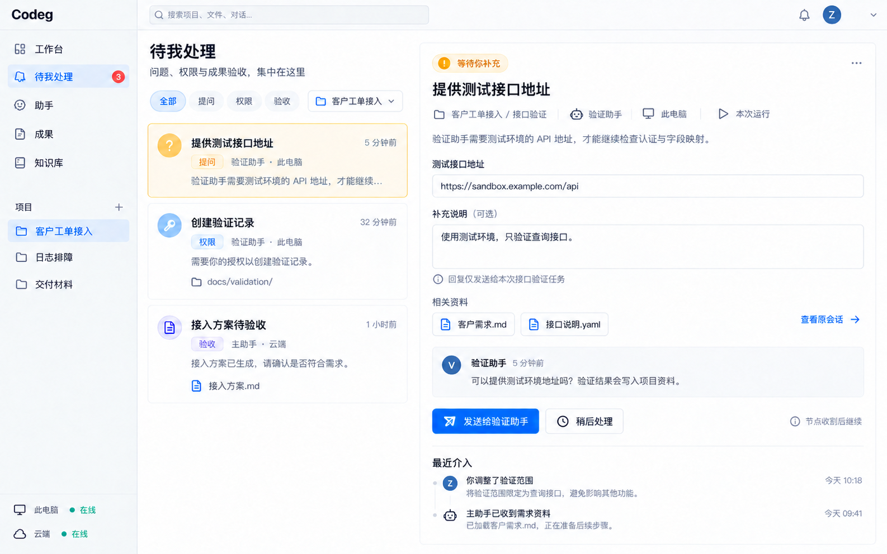
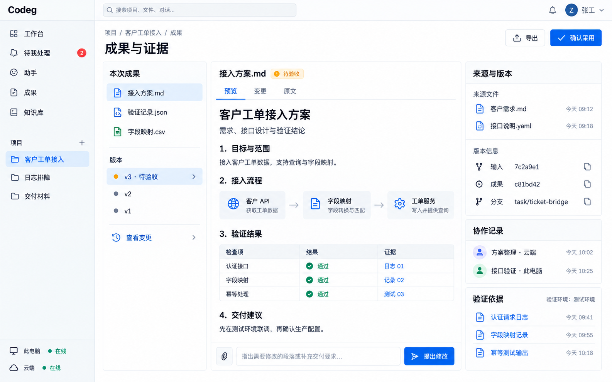
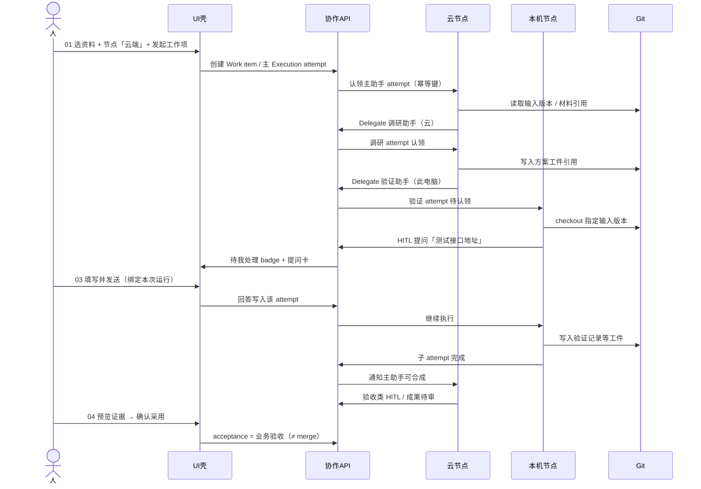
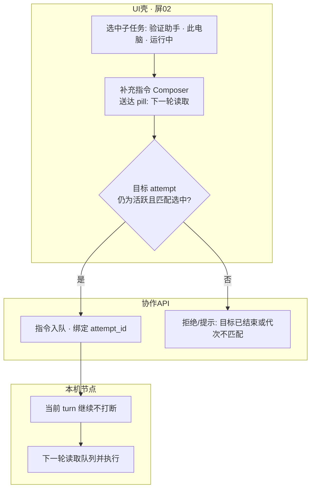
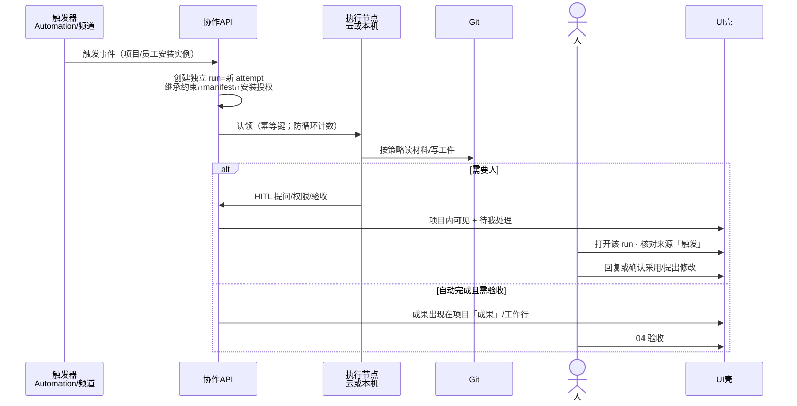

# 界面设计草图 · 用户工作模拟 · 操作示意

| 字段 | 内容 |
|------|------|
| **日期** | 2026-10-15（Asia/Manila） |
| **状态** | 方案包可视设计层（正式可评审；**非**高保真重画） |
| **隶属** | [`proposal.md`](proposal.md) §10 UI 与扩展 |
| **示例域** | 「客户工单接入」（与四张概念稿一致） |
| **架构立场** | Option A；项目一等公民；主助手 Delegate；云端\|此电脑=执行位置；待我处理=提问/权限/验收；确认采用≠Git merge；跨端 Git+API |

---

## 0. 本文用途

本文补齐正式方案中缺失的 **界面设计草图、用户工作模拟图、操作示意**，作为 [`proposal.md`](proposal.md) 的可视设计层专章。

| 关系 | 说明 |
|------|------|
| 与 proposal §10 | §10 保留 IA 基线表、G0→G2、AG-UI 定位与「需补状态」清单；**分区线框、旅程、逐步操作**以本文为准 |
| 与四张概念稿 | 草图引用并嵌入 [`../codeg-personal-workbench-mockups-2026-10-14/`](../codeg-personal-workbench-mockups-2026-10-14/) 的 PNG；不修改原图 |
| 与对象模型 | UI 控件映射到 Project / Work item / Digital employee / Execution attempt / Node / Artifact / HITL ticket（见 §4） |
| 不做 | 不推倒架构正文；不编造像素级尺寸或未证实数据；不替代工程 API 定稿 |

**阅读建议：** 先扫 §1 四屏分区 → 再走 §2 旅程 A/B/C → 拆任务时按 §3 操作示意与 §5 验收清单勾选。

---

## 1. 界面设计草图（Wireframes）

约定：线框只表达 **信息架构与操作关系**（侧栏 / 主区 / 右栏 / 底栏、关键控件名）。视觉色与组件风格以概念稿为准（浅色桌面、蓝主动作、青绿运行、琥珀待处理）。

公共壳（四屏共用）：

```text
┌─ Top bar: Codeg | 搜索 | 通知 | 用户 ─────────────────────────────────┐
│ ┌ Sidebar ~200px ──┐ ┌────────── 主工作区 ──────────┐ ┌ 右栏/详情 ─┐ │
│ │ 工作台           │ │ 面包屑 / 标题 / 主动作        │ │ （按屏）   │ │
│ │ 待我处理 (badge) │ │ Tabs / 内容分区               │ │            │ │
│ │ 助手 / 成果 / …  │ │                              │ │            │ │
│ │ 项目列表         │ │                              │ │            │ │
│ │ · 客户工单接入 ★ │ │                              │ │            │ │
│ │ ───────────────  │ │                              │ │            │ │
│ │ 此电脑 · 在线    │ │                              │ │            │ │
│ │ 云端 · 在线      │ │                              │ │            │ │
│ └──────────────────┘ └──────────────────────────────┘ └────────────┘ │
└──────────────────────────────────────────────────────────────────────┘
```

---

### 1.1 屏 01 — 项目工作台

**职责一句话：** 以项目为容器总览工作项、主助手对话与子卡、待处理与最新成果入口。

```text
┌ Sidebar ────────┐ ┌ 主区：项目 / 客户工单接入 ──────────────────┐ ┌ 右栏 ──────────┐
│ 工作台 ★        │ │ [新工作]                                     │ │ 待我处理       │
│ 待我处理 (2)    │ │ Tabs: 进行中 | 会话 | 成果 | 资料            │ │ · 提问卡       │
│ 助手 / 成果 …   │ │ 工作行:                                      │ │   [填写信息]   │
│ 项目            │ │  需求与方案 · 主助手 · 云端 · 进行中         │ │ 最新成果       │
│ · 客户工单接入★ │ │  接口验证 · Codex · 此电脑 · 等待你补充      │ │ · 接入方案.md  │
│ · 日志排障      │ │  交付材料 · 写作助手 · 云端 · 准备中         │ │ · 验证记录.json│
│ 底栏节点状态    │ │ ── 主助手 [云端] 对话 ──                     │ │ 项目约束       │
│ 此电脑·在线     │ │ 用户消息 / 助手拆线说明                      │ │ · 先验证测试环境│
│ 云端·在线       │ │ 子卡: 调研助手(云·完成) | 验证助手(端·等材料) │ │ · 交付需附证据 │
│                 │ │ 资料芯片 + repo 上下文                       │ │                │
│                 │ │ 底栏 Composer: 补充… | 选取资料 | 节点 | 发送 │ │                │
└─────────────────┘ └──────────────────────────────────────────────┘ └────────────────┘
```

| 区域 | 职责 | 关键控件 |
|------|------|----------|
| 侧栏项目列表 | 切换 Project；不等于 folder group | 选中「客户工单接入」 |
| 底栏节点行 | 显示 Node 在线；**界面所在窗口 ≠ 执行位置** | 「此电脑 · 在线」「云端 · 在线」 |
| 工作行 | Work item 摘要：负责员工、节点、状态 | 「新工作」、行点击进协作屏 |
| 主助手对话 + 子卡 | 主 attempt 与 Delegate 子卡（成果/阻塞） | 子卡进 02；阻塞进 03 |
| Composer | 发起/补充；节点选择器 = 本次执行位置 | 「选取资料」「云端\|此电脑」、发送 |
| 右栏待我处理 / 最新成果 | HITL 入口与 Artifact 快入口 | 「填写信息」「查看全部」 |
| 项目约束 | 只读项目级约束摘要 | — |

**概念稿：**



---

### 1.2 屏 02 — 多 Agent 协作

**职责一句话：** 同一工作项上的委托树、选中子员工实时工作区、补充指令（下一轮读取）、跨端版本交接。

```text
┌ Sidebar 同壳 ┐ ┌ 项目 / 客户工单接入 / 需求与方案 ─────────────────────────────┐
│              │ │ 多 Agent 协作                    [补充资料] [停止… ▾]         │
│              │ │ 上下文条: repo · 输入 commit · 资料芯片                       │
│              │ │ Tabs: 协作 | 活动 | 成果                                      │
│              │ │ ┌ 左 ~45%: 负责助手与子任务 ┐ ┌ 右 ~55%: 选中员工工作区 ────┐ │
│              │ │ │ 主助手 · 云端 · 进行中     │ │ 验证助手 [此电脑] 运行中     │ │
│              │ │ │ ├ 调研助手 · 云 · 已完成   │ │ 状态行 / 输入版本 / 成果分支 │ │
│              │ │ │ ├ 验证助手 · 端 · 运行中 ★ │ │ 活动时间线 + 日志面板       │ │
│              │ │ │ └ 方案复核 · 云 · 等待依赖 │ │ 产出行: 验证记录.json [预览] │ │
│              │ │ │ 脚注: N 节点 · 等待依赖    │ │ ── 给验证助手补充指令 ──    │ │
│              │ │ │ 跨端交接时间线             │ │ 文本 | 附件 | [下一轮读取]   │ │
│              │ │ │ · 云端提交 · hash         │ │              [发送]          │ │
│              │ │ │ · 此电脑读取指定版本       │ │                              │ │
│              │ │ └───────────────────────────┘ └──────────────────────────────┘ │
└──────────────┘ └───────────────────────────────────────────────────────────────┘
```

| 区域 | 职责 | 关键控件 |
|------|------|----------|
| 委托树 | 主助手 → 子员工层级；每行带 Node 与状态 | 行选中切换右区；**子完成 ≠ 主验收** |
| 右区工作区 | 当前 Execution attempt 的活动/日志/产出 | 「查看会话」 |
| 补充指令 Composer | 绑定选中子任务；送达语义可见 | 「下一轮读取」pill、「发送」 |
| 停止… | 展开范围（当前执行 / 整工作项） | 发送后等节点回执（见 §1.5、§3.7） |
| 跨端交接 | Git 版本时间线（云提交 → 本地读取） | 「查看交接记录」 |

**概念稿：**



---

### 1.3 屏 03 — 待我处理

**职责一句话：** 提问 / 权限 / 验收统一入口、底层分轨；每条绑定项目、工作项、员工、节点、**本次运行**。

```text
┌ Sidebar: 待我处理 ★ ┐ ┌ 待我处理 ─────────────────────────────────────────────┐
│ badge=2             │ │ 问题、权限与成果验收，集中在这里                         │
│                     │ │ Chips: 全部 | 提问 | 权限 | 验收 · 项目筛选              │
│                     │ │ ┌ 列表 ~33% ──────────┐ ┌ 详情 ~67% ──────────────────┐ │
│                     │ │ │ ★ 提问 · 提供测试…  │ │ [等待你补充] 提供测试接口地址 │ │
│                     │ │ │   验证助手·此电脑   │ │ 身份行: 项目/工作项/员工/节点 │ │
│                     │ │ │ 权限 · 创建验证记录 │ │       / 本次运行              │ │
│                     │ │ │ 验收 · 接入方案…    │ │ 说明文案                     │ │
│                     │ │ └─────────────────────┘ │ 表单: 地址 / 补充说明         │ │
│                     │ │                         │ 范围注: 仅发送给本次任务      │ │
│                     │ │                         │ 相关资料芯片 · 查看原会话     │ │
│                     │ │                         │ [发送给验证助手] [稍后处理]   │ │
│                     │ │                         │ 提示区: 节点收到后继续        │ │
│                     │ │ 最近介入（历史，非待办） │                              │ │
└─────────────────────┘ └─────────────────────────┴──────────────────────────────┘
```

| 区域 | 职责 | 关键控件 |
|------|------|----------|
| Tab 芯片 | 三态分轨过滤 | 全部 / 提问 / 权限 / 验收 |
| 列表卡 | 类型徽章 + 员工 + 节点 + 时间 | **禁止**统一成单一「批准」按钮 |
| 详情身份行 | 持久化绑定 attempt | 展示「本次运行」 |
| 提问表单 | 回答进入该 attempt 上下文 | 「发送给…」「稍后处理」 |
| 权限详情（同壳） | 授予/拒绝具体操作 | **≠** 整任务验收 |
| 验收详情（同壳） | 跳转成果或内联预览 | 「提出修改」「确认采用」入口 |

**概念稿：**



---

### 1.4 屏 04 — 成果与证据

**职责一句话：** 预览工件、对照来源与验证依据；「提出修改」或「确认采用」（业务验收，**不是** merge/发布）。

```text
┌ Sidebar 同壳 ┐ ┌ 项目 / 客户工单接入 / 成果 ───────────────────────────────────┐
│              │ │ 成果与证据                         [导出]  [确认采用]         │
│              │ │ ┌ 文件列 ~220 ┐ ┌ 预览 ~620 ──────────────┐ ┌ 证据栏 ~300 ┐ │
│              │ │ │ 本次成果     │ │ 接入方案.md [待验收]     │ │ 来源与版本   │ │
│              │ │ │ · 接入方案★  │ │ Tabs: 预览|变更|原文     │ │ 输入 commit  │ │
│              │ │ │ · 验证记录   │ │ Markdown 正文           │ │ 成果 commit  │ │
│              │ │ │ · 字段映射   │ │                         │ │ 协作记录     │ │
│              │ │ │ 版本         │ │                         │ │ · 方案·云端  │ │
│              │ │ │ · v3 待验收★ │ │                         │ │ · 验证·此电脑│ │
│              │ │ │ · v2 / v1    │ │                         │ │ 验证依据     │ │
│              │ │ │ [查看变更]   │ │ 底栏: 指出需修改…       │ │ 环境说明     │ │
│              │ │ └─────────────┘ │       [提出修改]         │ └─────────────┘ │
└──────────────┘ └─────────────────┴─────────────────────────┴─────────────────┘
```

| 区域 | 职责 | 关键控件 |
|------|------|----------|
| 本次成果列表 | Artifact 集合 | 选中切换预览 |
| 版本区 | 工件版本 / commit / hash | 「查看变更」；无强制 merge |
| 预览 Tabs | 内容 / diff / 原文 | 预览|变更|原文 |
| 证据栏 | 输入版本、成果版本、协作记录、验证依据 | 可点开证据项 |
| 验收动作 | 业务验收闭环 | 「提出修改」「确认采用」— **≠ Git merge** |

**概念稿：**



---

### 1.5 补全状态草图（概念稿未画全）

以下仅线框，对应 proposal §10.4。不声称已有高保真稿。

#### 1.5.1 离线重连

```text
┌ 顶栏横幅（琥珀）: 此电脑节点离线 · 上次心跳 HH:MM · [重试连接] [仅查看云端任务] ─┐
│ 侧栏底: 此电脑 · 离线(灰) | 云端 · 在线                                         │
│ 主区工作行/委托树: 依赖本机的 attempt 显示「等待节点」；不可对离线节点发 Stop 抢跑 │
│ 待我处理: 发往本机的回复进入「待送达」；重连后显示节点回执                        │
└──────────────────────────────────────────────────────────────────────────────────┘
```

| 要点 | 说明 |
|------|------|
| 不抢占 | 未连上节点前不假装已停止/已送达 |
| 降级 | 允许继续操作仅云端可执行的工作项 |

#### 1.5.2 等待 Git 同步

```text
┌ 成果屏或协作屏「跨端交接」区 ──────────────────────────────────────────────────┐
│ 状态条(青绿/中性): 等待 Git 同步 · 云端成果 c81bd42 → 此电脑拉取中…            │
│ 时间线: ① 云端提交方案 · 8d17ac2  ✓  ② 此电脑 checkout 指定版本  …同步中       │
│ 动作: [刷新状态]  （禁用「在本机开始验证」直到 input_commit 就绪）                │
│ 失败时: 同步失败 · 原因摘要 · [重试] [改用交付目录+hash 路径(若项目允许)]        │
└──────────────────────────────────────────────────────────────────────────────────┘
```

| 要点 | 说明 |
|------|------|
| 门禁 | 本地验证 attempt 认领前须看到目标输入版本就绪 |
| 无 Git | 报告类可走交付目录 + hash（proposal §6.2），UI 换标签不换验收语义 |

#### 1.5.3 Stop 范围确认

```text
┌ 模态/下拉面板「停止…」─────────────────────────────────────────────────────────┐
│ 工作项: 需求与方案                                                              │
│ ○ 仅当前执行 — 验证助手 · 此电脑 · 本次运行                                     │
│ ○ 整工作项 — 停止本工作项下全部活跃子执行（不含定时/Automation 计划）           │
│ 说明: 发送后等待各节点回执；回执前界面显示「尚未确认」                           │
│                                    [取消]  [确认停止]                            │
└──────────────────────────────────────────────────────────────────────────────────┘
│ 发送后: 树节点状态 → 停止中… → 已停止(节点回执) / 尚未确认(超时可重试指令)       │
```

| 要点 | 说明 |
|------|------|
| 范围必选 | 禁止无范围的「停止」 |
| 回执 | Stop 完成以节点回执为准（proposal §8.3） |

---

## 2. 用户工作模拟图（Journeys）

示例项目：**客户工单接入**。参与者简称：人、UI壳、协作API、云节点、本机节点、Git。

### 2.1 Journey A — 从需求材料发起 → 云端编队 → 本地验证 → 待我处理 → 确认采用

**故事：** 人在项目工作台选取「客户需求.md」等材料，指定云端主助手发起「需求与方案」；主助手 Delegate 调研（云）与验证（此电脑）；验证助手提问测试地址；人回复后本机跑完；主助手汇总；人在成果屏确认采用方案文档。



**屏幕落点：**

| 步骤 | 用户看哪一屏 | 点什么 |
|------|--------------|--------|
| 发起 | 01 项目工作台 | 「选取资料」、节点「云端」、Composer 发送 / 「新工作」 |
| 看编队 | 02 多 Agent 协作 | 委托树；选中「验证助手」看本机活动 |
| 看交接 | 02 跨端交接区 | 云提交 hash → 本机读取 |
| 答提问 | 03 待我处理 · 提问 | 「发送给验证助手」 |
| 验收 | 04 成果与证据 | 「确认采用」（或先「提出修改」） |

---

### 2.2 Journey B — 运行中补充指令（下一轮读取）与错误送达防护

**故事：** 验证助手在此电脑运行中；人针对**选中的**验证子任务补充「同时检查幂等」；送达模式为「下一轮读取」。系统禁止把指令写到已结束的调研 attempt 或错误代次。



**屏幕落点：**

| 步骤 | 用户看哪一屏 | 点什么 |
|------|--------------|--------|
| 选定目标 | 02 左树 | 点击「验证助手」行（必须先选中） |
| 编写指令 | 02 右区底栏 | 输入文本；确认 pill「下一轮读取」；「发送」 |
| 错误防护反馈 | 02 或 Toast | 若选中已完成子任务：提示「请选择活跃执行」——**禁止静默投递到主助手或其他子任务** |
| 生效确认 | 02 活动时间线 | 下一轮出现「已读取补充指令」类事件（实现文案可迭代） |

**禁止混淆：** 「下一轮读取」≠ 立即打断当前工具调用；补充指令 ≠ 新开 Work item。

---

### 2.3 Journey C — 定时/频道触发一次独立 run 的人机核对

**故事：** 项目上安装的 Automation（或频道入站）触发一次**独立** Execution attempt；人在项目工作台或待我处理中发现该 run，核对其继承的项目约束与授权后验收或驳回修改。



**屏幕落点：**

| 步骤 | 用户看哪一屏 | 点什么 |
|------|--------------|--------|
| 发现 | 01 进行中工作行或「会话/活动」 | 带「触发」来源标签的工作项/子行 |
| 或从 HITL | 03 | 筛选项目「客户工单接入」；打开对应卡 |
| 核对 | 02 或详情身份行 | 确认 attempt 绑定、节点、权限继承说明 |
| 验收 | 04 | 与手动发起相同的「提出修改 / 确认采用」 |

**禁止混淆：** 触发 run **是**独立 attempt，不是续跑某人正在看的对话；「停止整工作项」**不含**误杀定时计划本身（proposal §8.3）。

---

## 3. 操作示意（Task flows）

每步格式：**界面动作 → 界面反馈 → 底层对象变更（一行）**。关键处标注禁止混淆。

### 3.1 在项目工作台发起工作项并选执行节点

| # | 界面动作 | 界面反馈 | 底层对象变更 |
|---|----------|----------|--------------|
| 1 | 侧栏选中项目「客户工单接入」 | 主区切换为该项目工作台 | UI 上下文 = `project_id` |
| 2 | 「选取资料」或附加芯片（如客户需求.md） | Composer 上方出现资料芯片 + repo/版本上下文 | 草稿挂 `materials` / `input_commit|hash` |
| 3 | 节点选择器选「云端」或「此电脑」 | 选择器显示当前执行位置 | 草稿 `node_id` = cloud\|local |
| 4 | 输入目标并发送 / 「新工作」 | 新工作行出现；主助手对话区启动 | 创建 `WorkItem` + 主 `ExecutionAttempt`；API 投递认领 |

**禁止混淆：** 节点选择 = **执行位置**，不是「界面打开在哪台电脑」；侧栏 folder ≠ Project。

---

### 3.2 主助手委托子员工（调研 / 验证）

| # | 界面动作 | 界面反馈 | 底层对象变更 |
|---|----------|----------|--------------|
| 1 | （系统/主助手）发起 Delegate | 01 出现子卡；02 树出现子行 | 创建子 `ExecutionAttempt`（`parent_attempt_id`）+ `DelegateRequest` |
| 2 | 人打开 02，点「调研助手」 | 右区显示云端已完成与「接入方案.md」 | 读子 attempt 状态与 `artifact_refs` |
| 3 | 人点「验证助手」 | 右区显示此电脑运行中/等待材料 | 展示子 attempt 的 `node_id=local` |

**禁止混淆：** **子任务完成 ≠ 主项业务验收**；Delegate 默认主助手保留合成权（非 Handoff 交棒）。

---

### 3.3 跨端交接（版本时间线：云提交 → 本地 checkout）

| # | 界面动作 | 界面反馈 | 底层对象变更 |
|---|----------|----------|--------------|
| 1 | 在 02 查看「跨端交接」 | 时间线条：云端提交方案 · `8d17ac2` | 云 attempt 写入成果引用 / commit |
| 2 | （自动或人触发本机验证） | 「此电脑读取指定版本」；或见 §1.5.2 同步中 | 本机 attempt 认领；`git checkout`/`fetch` 目标输入版本 |
| 3 | 同步完成 | 本机工作区显示 `输入版本 …`；允许继续跑 | attempt.`input_commit` 就绪；进入可执行态 |

**禁止混淆：** Git 管材料/工件**版本引用**；委托/HITL/Stop 走 API，不靠 Git 传控制信号。

---

### 3.4 回复「提问」类待处理（绑定本次运行）

| # | 界面动作 | 界面反馈 | 底层对象变更 |
|---|----------|----------|--------------|
| 1 | 01 右栏或侧栏 badge 进入 03 | 列表定位到提问卡 | 打开 `HitlRequest(kind=question)` |
| 2 | 核对身份行（项目/工作项/员工/节点/本次运行） | 范围注：「回复仅发送给本次…」 | UI 锁定 `attempt_id` |
| 3 | 填写并「发送给验证助手」 | 提示「节点收到后继续」；卡离开待办或进已送达 | 回答写入该 attempt 上下文；状态离开纯等待（以节点回执为准） |
| 4 | 可选「稍后处理」 | 卡保留；不改变错误代次绑定 | HITL 仍挂原 `attempt_id` |

**禁止混淆：** 回答不得落到错误代次；提问回复 ≠ 权限授予 ≠ 确认采用。

---

### 3.5 授权「权限」请求

| # | 界面动作 | 界面反馈 | 底层对象变更 |
|---|----------|----------|--------------|
| 1 | 03 Tab「权限」打开卡（如「创建验证记录」） | 展示路径/工具范围提示 | `HitlRequest(kind=permission)` |
| 2 | 允许或拒绝具体操作 | 允许：节点继续；拒绝：attempt 记录拒绝原因 | 更新节点侧 grants / 能力令牌交集 |
| 3 | 返回工作台 | 验证助手继续或阻塞原因可见 | attempt 状态迁移；**不**自动把主 work item 标为已验收 |

**禁止混淆：** **权限允许 ≠ 成果验收**；≠ 本任务内所有写操作预授权。

---

### 3.6 成果「提出修改」vs「确认采用」

| # | 界面动作 | 界面反馈 | 底层对象变更 |
|---|----------|----------|--------------|
| 1 | 04 选中「接入方案.md」v3，预览+证据栏 | 待验收 pill；来源/成果 commit；协作记录 | 展示 Artifact + Evidence |
| 2a | 「提出修改」+ 说明 | 主助手/负责方收到修改请求；版本可继续迭代 | HITL acceptance 回环；可派新 attempt 或同链续跑（产品策略显式） |
| 2b | 「确认采用」 | 文档业务验收通过；可触发保存/导入等落点策略 | `WorkItem`/`Artifact` 业务验收状态更新 |

**禁止混淆：**

| 是 | 不是 |
|----|------|
| 确认采用 = **业务验收** | **不是** Git merge |
| 确认采用 | **不是** 发布 / 部署 |
| 提出修改 | **不是** 静默覆盖已确认版本 |

---

### 3.7 Stop：选范围并等节点回执

| # | 界面动作 | 界面反馈 | 底层对象变更 |
|---|----------|----------|--------------|
| 1 | 02 点「停止…」 | 打开范围面板（§1.5.3） | — |
| 2 | 选「仅当前执行」或「整工作项」 | 确认文案展示影响范围；注明不含定时计划 | 草稿 Stop 范围 |
| 3 | 「确认停止」 | 目标行显示「停止中…」「尚未确认」 | API 下发 Stop；等待各 `node_id` 回执 |
| 4 | 节点回执 | 「已停止」；未连上保持尚未确认，可重试指令 | attempt 终止态；整工作项则级联活跃子 attempt |

**禁止混淆：** 回执前不抢占；停止工作项 ≠ 删除触发器计划；停止 ≠ 自动在另一节点故障接管。

---

### 3.8 触发器产生的 run：发现与验收

| # | 界面动作 | 界面反馈 | 底层对象变更 |
|---|----------|----------|--------------|
| 1 | 触发器到点/频道入站（人可不在场） | 之后在 01 出现带「触发」来源的工作行/会话 | 新独立 `ExecutionAttempt` + 幂等键 |
| 2 | 人打开该行 → 02/详情 | 可见继承的项目约束与员工/授权摘要 | 只读展示触发安装上下文 |
| 3 | 若有 HITL → 03 | 与手动 run 相同三态 | 同一 `HitlRequest` 模型 |
| 4 | 成果 → 04 | 提出修改 / 确认采用 | 与 §3.6 相同验收语义 |

**禁止混淆：** 每次触发 = **独立 run**；防循环超限应在 UI 显示「已抑制」而非静默连跑（proposal §9.3）。

---

## 4. 与对象模型对照表

| UI 元素（控件/区域） | 主要对象 | 说明 |
|----------------------|----------|------|
| 侧栏「项目」选中项 | **Project** | 约束、资料索引、编队、默认节点；≠ folder group |
| 底栏「此电脑 / 云端」在线 | **Node** | `kind=local\|cloud`；心跳与能力 |
| Composer 节点选择器 | **Node**（本次） | 写入新 attempt 的 `node_id` |
| 工作行（需求与方案等） | **Work item** | 可并行主任务单元 |
| 「主助手」对话区 | **Digital employee** + 主 **Execution attempt** | 身份可在不同节点跑 |
| 子卡 / 委托树行 | **Digital employee** + 子 **Execution attempt** | `parent_attempt_id`；带节点标签 |
| 「下一轮读取」补充指令 | **Execution attempt**（选中） | 指令队列绑定 `attempt_id` |
| 「停止…」范围 | **Execution attempt** / **Work item** | 当前执行 vs 整工作项级联 |
| 跨端交接时间线条 | **Artifact** 版本引用 + **Git** | commit/hash；非控制面 |
| 待我处理列表卡 | **HITL ticket**（`HitlRequest`） | kind=question\|permission\|acceptance |
| 详情「本次运行」 | **Execution attempt** | 强制绑定，防错代 |
| 成果文件行 / 版本 vN | **Artifact** | 版本号 / commit / hash |
| 证据栏、验证依据 | **Evidence**（关联 Artifact） | 来源、协作记录、验证输出 |
| 「确认采用」 | Work item / Artifact 业务验收 | **≠** merge/发布 |
| 「提出修改」 | HITL acceptance 回环 | 继续迭代，不自动 merge |
| 触发来源标签 | Trigger 安装实例 → 新 **Execution attempt** | 独立 run |

---

## 5. 首期可视化验收清单

产品/设计可勾选「能看见什么」。对齐 proposal §12 故事，仅列 **可见性** 门禁（不代替后端验收）。

### 5.1 四屏壳与导航

- [ ] 侧栏固定：工作台、待我处理（badge）、助手、成果、知识库、项目列表、底栏双节点状态  
- [ ] 项目「客户工单接入」可进入 01，并钻取到 02/03/04  
- [ ] 界面窗口位置与任务执行位置可同时辨认（底栏节点 vs 行内/芯片「云端\|此电脑」）

### 5.2 项目工作台（01）

- [ ] 可见多条工作行：负责员工、执行节点、状态  
- [ ] 主助手对话下可见 Delegate 子卡（完成物或阻塞原因）  
- [ ] Composer 可选取资料并选择执行节点后发起  
- [ ] 右栏可见待我处理摘要与最新成果入口  

### 5.3 多 Agent 协作（02）

- [ ] 委托树展示主/子层级、节点、状态（非百分比糊弄）  
- [ ] 选中子任务后右区为该 attempt 的活动/日志/产出  
- [ ] 补充指令 Composer 绑定选中子任务，并显示「下一轮读取」（或其它送达语义）  
- [ ] 跨端交接时间线至少能表达：云提交 → 本机读取指定版本  
- [ ] 「停止…」可选范围；发送后出现「停止中/尚未确认/已停止」  

### 5.4 待我处理（03）

- [ ] Tab：全部 / 提问 / 权限 / 验收；类型不合并成单一批准  
- [ ] 详情身份行含项目、工作项、员工、节点、**本次运行**  
- [ ] 提问发送后有「等待节点回执」类反馈，且「稍后处理」不丢绑定  
- [ ] 权限卡展示具体操作范围；允许/拒绝后果可理解  

### 5.5 成果与证据（04）

- [ ] 文件列表 + 版本 + 预览/变更/原文  
- [ ] 证据栏区分输入版本与成果版本，并有协作记录与验证依据  
- [ ] 同时存在「提出修改」与「确认采用」；文案/流程不称为 merge/发布  

### 5.6 补全状态（概念稿外）

- [ ] 节点离线横幅 + 侧栏离线态；对离线节点的 Stop/送达不假装成功  
- [ ] 等待 Git 同步（或交付目录+hash）状态可看见，未就绪时禁用依赖该版本的本机开跑  
- [ ] 触发产生的 run 在项目内可发现（来源标签），验收路径与手动 run 一致  

### 5.7 反混淆（可见文案或结构）

- [ ] 子卡「已完成」不会单独把主工作项标成「已验收」  
- [ ] 「确认采用」与 Git merge / 部署入口分离  
- [ ] 补充指令在目标 attempt 无效时有明确错误提示，不静默投错  

---

## 参考

| 材料 | 路径 |
|------|------|
| 正式方案正文 | [`proposal.md`](proposal.md) |
| 概念稿包 | [`../codeg-personal-workbench-mockups-2026-10-14/README.md`](../codeg-personal-workbench-mockups-2026-10-14/README.md) |
| 01–04 PNG | `../codeg-personal-workbench-mockups-2026-10-14/01-project-workbench.png` 等 |
| 布局语义 prompts | `../codeg-personal-workbench-mockups-2026-10-14/prompts/` |

---

*本文为方案包可视设计层；实现以工程里程碑为准，线框不约束像素尺寸。*
