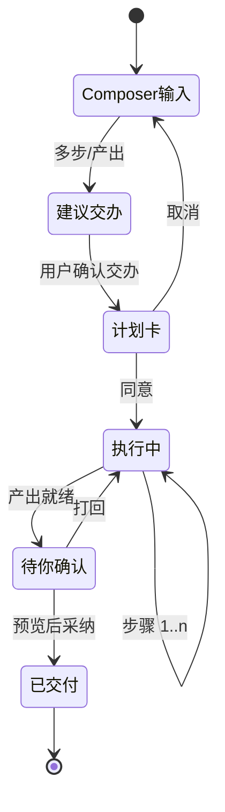
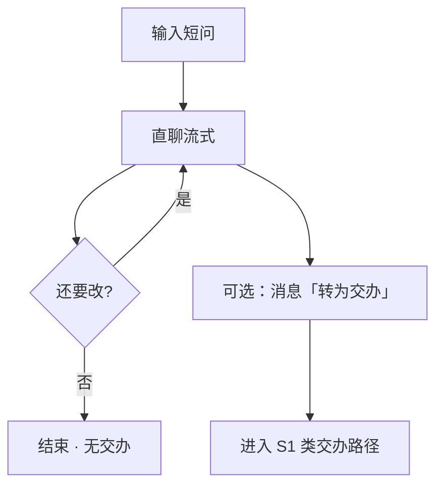
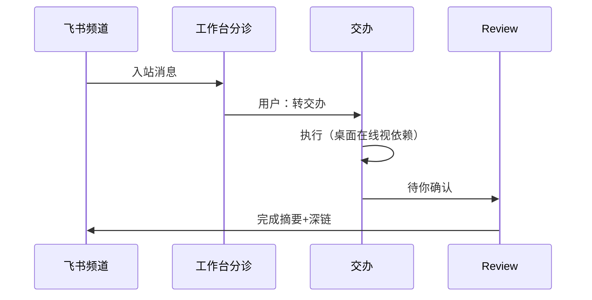
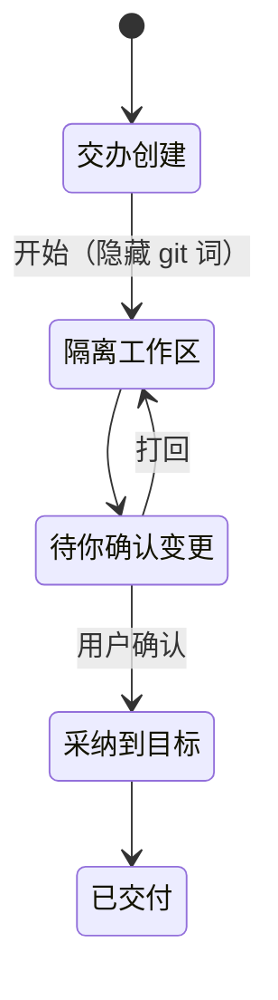
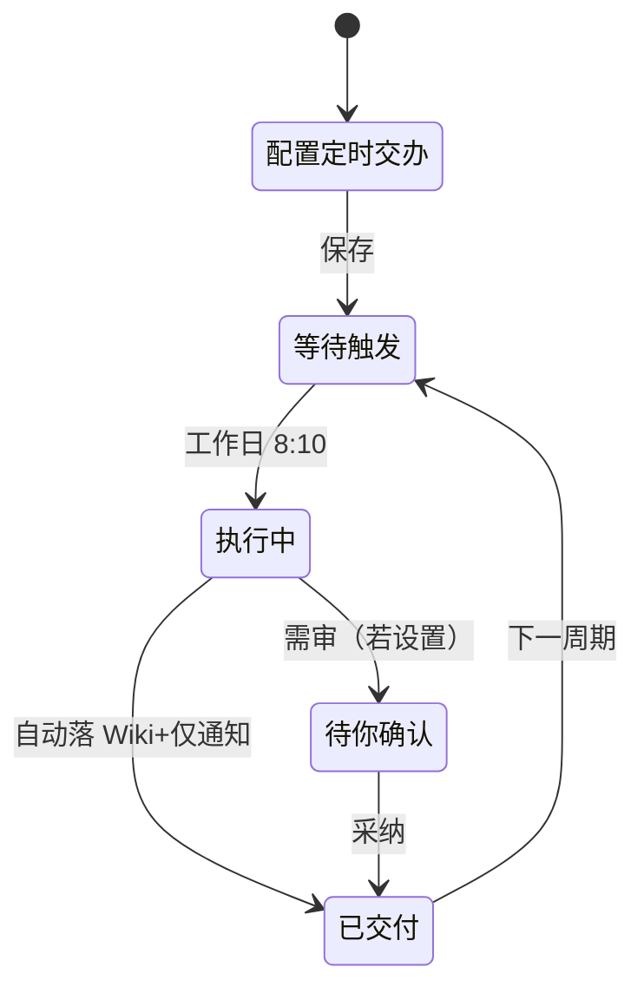

# CodeG 场景设计草图（S1–S6）

**说明：** 每个场景含用户旅程 + 界面状态流转。线框细节见 `wireframes.md`（W1–W8）。  
**产品定调：** 默认像 Cowork/Work；打开代码仓库再露 git / 多 coding agent。

---

## S1 写周报：描述 → 交办 → 离开 → 通知 → 预览采纳

**人物：** 个人知识工作者 Mack  
**目标：** 调研并写成一页周报，写入 Wiki，全程不见 git 术语。

### 用户旅程

| 步 | 用户行为 | 系统响应 | 界面状态 |
|----|----------|----------|----------|
| 1 | 在工作台输入「调研竞品 A/B，写成周报，引用进 Wiki」 | 启发式判定多步交付 | W2-b 建议「转为交办」 |
| 2 | 点「转为交办」 | 建 To-do；若会写 Wiki → 计划卡 | W4 计划确认 |
| 3 | 同意计划；去开会 | 执行中；步骤推进 | W3 进度 + 托盘「进行中」 |
| 4 | （离开） | 完成后系统通知 + 可选飞书 | W7 完成通知 |
| 5 | 点通知回来 | Review 主视图 = 周报预览 | W5 交付预览 |
| 6 | 选择「写入 Wiki」并采纳 | 看板 → 已交付；Wiki 可 @ | W8 + 交办「已交付」 |

### 状态流转



### 关键界面序列（ASCII）

```
[W1 工作台] → [W2 转为交办] → [W4 计划卡] → [W3 执行中/离开]
      → [W7 通知] → [W5 预览采纳] → [W8 Wiki 落点]
```

**成功标准：** 全程文案为「隔离工作区 / 待你确认 / 采纳」；无 worktree/merge。

---

## S2 快问一句：不升交办的短路径

**人物：** 任一用户  
**目标：** 改三句文案，10 秒内结束，不产生托盘噪音。

### 用户旅程

| 步 | 用户行为 | 系统响应 | 界面状态 |
|----|----------|----------|----------|
| 1 | Composer：「把这三句改口语一点」+ 粘贴 | 判为短问，直聊 | W2-a |
| 2 | 流式看回复；再追问「再短一点」 | 同会话继续；消息可排队 | 会话内 |
| 3 | 满意，复制走人 | 不建 To-do；托盘无变化 | W1 最近会话一条「已完成」快问 |

### 状态流转



```
[W1] → [W2-a 短问] → 复制结束
              └▸ 可选升级交办 → S1
```

**成功标准：** 不强迫选模式；不误建交办；需要时仍能升级。

---

## S3 飞书频道来活：分诊 → 交办 → 回频道

**人物：** Mack（手机不在桌前也可先分诊）  
**目标：** 频道问题进交办，做完摘要回到同一频道。

### 用户旅程

| 步 | 用户行为 | 系统响应 | 界面状态 |
|----|----------|----------|----------|
| 1 | 飞书 #产品 有人问「客户问题谁跟」 | 入站到工作台分诊 | W7 分诊卡 |
| 2 | 点「转交办」，补充「整理背景+建议回复」 | 建交办；可能出计划卡（若要回帖） | W4 → W3 |
| 3 | 桌面执行（或后做的云 worker） | 进度在托盘 | W3 |
| 4 | 待确认：建议回复文案预览 | Review 预览 | W5 |
| 5 | 采纳并允许回传 | 飞书帖摘要 + 深链 | W7 回传 |

### 状态流转



```
[频道] → [W7 分诊] → [W4/W3 交办] → [W5 确认] → [W7 回传]
```

**成功标准：** 入站 / 出站语义一致（完成·需确认·失败）；频道侧不假装本机 Agent。

---

## S4 改文档但不要碰 git 术语：隔离工作区 → 确认 → 采纳

**人物：** 非开发向用户  
**目标：** 整理「下载/报告」文件夹里的文档，界面无 git 词。

### 用户旅程

| 步 | 用户行为 | 系统响应 | 界面状态 |
|----|----------|----------|----------|
| 1 | 「整理下载里的报告，生成目录说明」 | 转为交办；工作区=普通文件夹 | W2 → 非编码文案 |
| 2 | 见计划：「在隔离工作区生成说明.md」 | 无 branch/worktree 字样 | W4 |
| 3 | 执行中步骤用人话 | 「复制到隔离区 → 生成说明 → 待你确认」 | W3 |
| 4 | Review：预览说明.md；变更明细可展开 | 主预览、次 diff | W5 |
| 5 | 「采纳到目标文件夹」 | 已交付 | 看板列「已交付」 |

### 与编码路径对照（文案层）

| 概念 | S4 非编码 | S5 编码仓库 |
|------|-----------|-------------|
| 隔离 | 隔离工作区 | worktree |
| 等待用户 | 待你确认 | Review |
| 落地 | 采纳到目标位置 | Merge |
| 主审视图 | 交付预览 | live diff（可并列预览） |

### 状态流转



```
[W2] → [W4 人话计划] → [W3] → [W5 预览·采纳] 
文案：隔离工作区 / 待你确认 / 采纳
```

**成功标准：** UI 默认不出现 worktree/merge/branch；高级信息可展开。

---

## S5 打开代码仓库：露出 agent / diff / worktree（对比 S4）

**人物：** 会写代码的 Mack  
**目标：** 同一产品内回到编码深度，不丢护城河。

### 用户旅程

| 步 | 用户行为 | 系统响应 | 界面状态 |
|----|----------|----------|----------|
| 1 | 打开本地 git 仓库作为工作区 | 上下文切换为「编码」 | 导航露出 agent / Canvas 入口 |
| 2 | `@` 测试代理 + 主办改 bug | 多代理卡片 + live diff | W6 + ACP diff |
| 3 | 交办「修 flaky test」 | To-do 走 worktree → Review → Merge | 编码文案 |
| 4 | Review 默认突出 diff；可看文件 | 与 S4 同壳，权重不同 | W5 编码侧重 |
| 5 | Merge 回主工作区 | 已合并 / 已交付 | 看板 |

### 状态流转（对比 S4）

```mermaid
flowchart TB
  subgraph S4["S4 普通文件夹"]
    A1[隔离工作区] --> A2[待你确认] --> A3[采纳]
  end
  subgraph S5["S5 代码仓库"]
    B1[worktree] --> B2[Review + live diff] --> B3[Merge]
    B0[@ 多 coding agent] --> B1
  end
```

```
打开仓库 → 露出 [@代理][Canvas][diff]
交办 → worktree → Review(diff 主) → Merge
对比 S4：同引擎，不同文案与默认主视图
```

**成功标准：** 开发者零能力损失；与 S4 切换仅随工作区类型，不靠用户「再选一个产品模式」。

---

## S6 定时早间简报

**人物：** Mack  
**目标：** 工作日 8:10 自动出简报，通知到达，可扫一眼。

### 用户旅程

| 步 | 用户行为 | 系统响应 | 界面状态 |
|----|----------|----------|----------|
| 1 | Composer / 交办：「工作日 8:10 汇总昨日频道+日历要点」 | 建定时交办 | W2 + 定时控件 |
| 2 | 确认计划（读频道、写简报、通知） | 写入 Automations / schedule | W4 |
| 3 | （次日 8:10） | 到点执行；步骤短链 | W3（可后台） |
| 4 | 通知「早间简报到」 | 预览一页简报；可写入 Wiki | W7 → W5 / W8 |
| 5 | 扫一眼 / 归档 | 已交付；下个工作日继续 | 交办 schedule 保留 |

### 状态流转



```
[W2 设定时] → [W4 计划] → （等待）→ [W3 短跑] → [W7 通知]
 → [W5/W8 简报预览或 Wiki]
```

**成功标准：** 「写一次、按时出结果」；若依赖本机文件则标明桌面需在线；纯频道摘要类可强调通知闭环。

---

## 场景 × 线框映射

| 场景 | 主线框 | 规格章节 |
|------|--------|----------|
| S1 写周报 | W1 W2 W3 W4 W5 W7 W8 | §4.1–4.5, 4.7, 4.9 |
| S2 快问 | W1 W2 | §4.1, 4.8 |
| S3 飞书来活 | W7 W3 W4 W5 | §4.7, 4.2 |
| S4 改文档无 git 词 | W2 W3 W4 W5 | §4.5, 4.4 |
| S5 开代码仓库 | W5 W6 + ACP diff | §4.10, 4.6 |
| S6 早间简报 | W2 W3 W4 W7 W8 | §4.8, 4.2 |

---

## 跨场景原则（提醒）

1. **同一 Composer** 贯穿 S1/S2/S6，差异只在是否升交办与是否定时。  
2. **S4 vs S5** 是文案与默认主视图的分叉，不是两套产品。  
3. **通知三态**（完成 / 需确认 / 失败）在 S1/S3/S6 复用。  
4. **移动端**在所有场景仅承诺：进度、问答、批准、看预览；重活回桌面。
