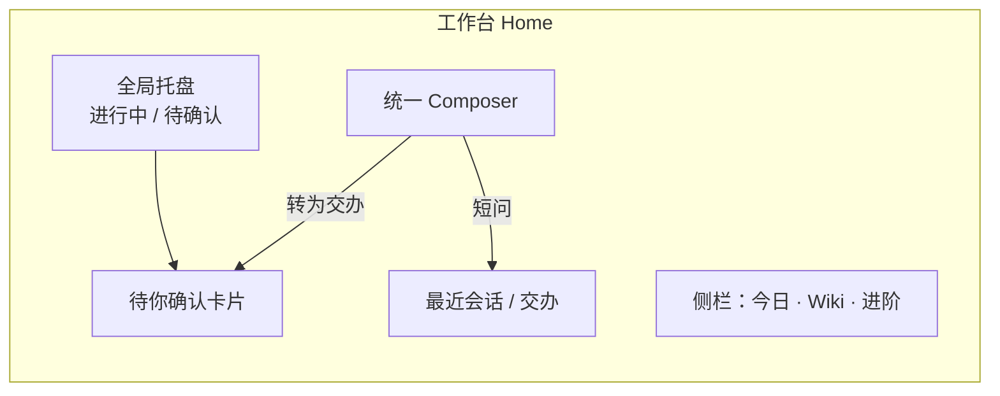
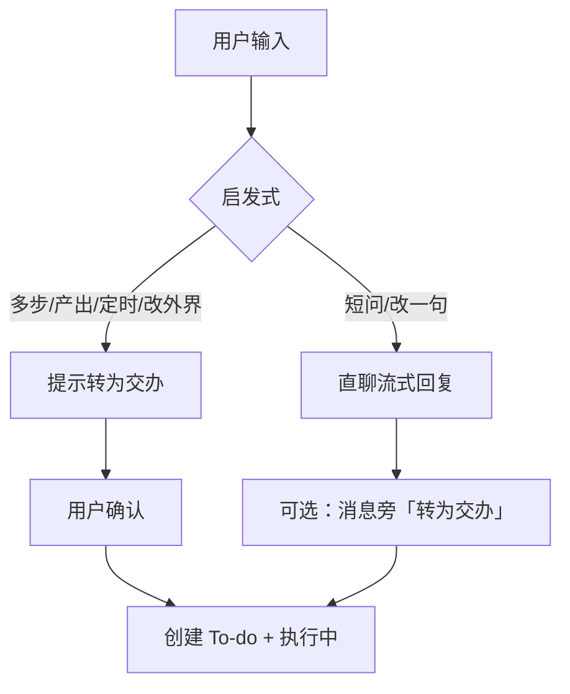
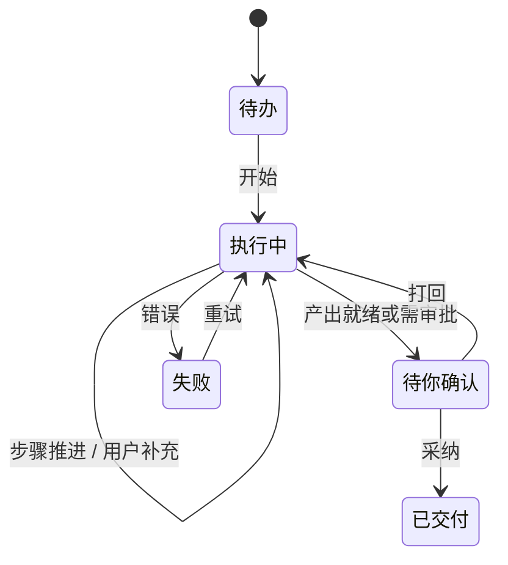
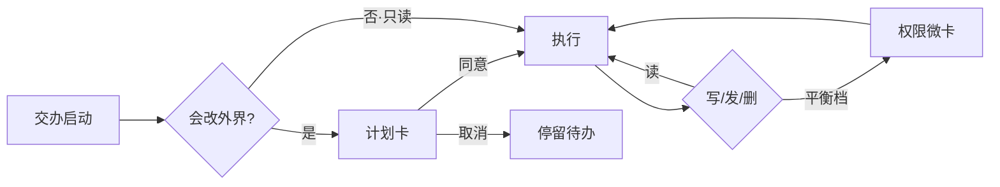
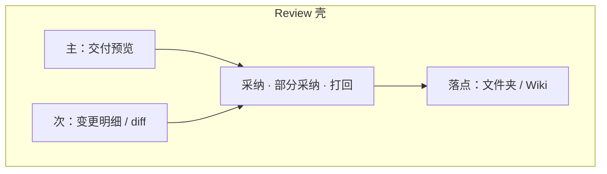
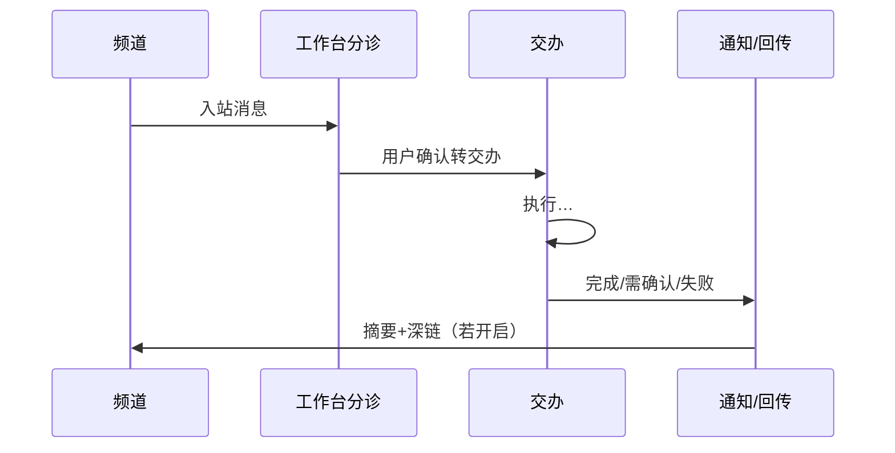

# CodeG 界面草图合集（W1–W8）

**说明：** 产品线框，非高保真。标注关键分区与控件即可。配套 `product-spec.md`、`scenarios.md`。  
**图例：** `[按钮]` `「输入」` `(徽标)` `···` 次要操作

---

## W1 首页 / 工作台总览

**图题：** 个人工作代理台首页——托盘、Composer、待确认与最近会话同屏。

```
┌──────────────────────────────────────────────────────────────────────────┐
│ CodeG          [工作台]  交办  知识  频道          (进行中 2) (待确认 1) ⚙ │
├────────────┬─────────────────────────────────────────────────────────────┤
│            │  早安，Mack · 周三                                          │
│  今日焦点   │ ┌─────────────────────────────────────────────────────────┐ │
│            │ │  ✦ 有什么要办？或直接问一句…                              │ │
│  · 周报交办 │ │     [@文件] [@Wiki] [定时]          [发送] [转为交办]   │ │
│  · 早间简报 │ └─────────────────────────────────────────────────────────┘ │
│            │                                                             │
│  ───────── │  ┌─ 待你确认 ─────────────────────────────────────────────┐ │
│  知识 Wiki  │  │  [文档] 竞品调研周报 v2   [打开预览]  [采纳]  [打回]    │ │
│  · 最近页   │  └───────────────────────────────────────────────────────┘ │
│  · 导入…    │                                                             │
│            │  最近会话                                                    │
│  进阶 ▸    │  · 整理桌面下载文件夹（执行中 · 步骤 3/5）                    │
│  Canvas    │  · 快问：把这段改口语一点（已完成）                           │
│  多代理    │  · 飞书 #产品：客户问题分诊（待办）                           │
└────────────┴─────────────────────────────────────────────────────────────┘
```



**说明：**  
- 默认落点是工作台，不是 Canvas。  
- 右上角托盘始终可见。  
- Composer 同时露出「发送」与主按钮「转为交办」。

---

## W2 Composer 统一输入（短问 vs「转为交办」）

**图题：** 同一输入框的两种路径——快问直聊，多步升交办。

### W2-a 短问（不升交办）

```
┌─────────────────────────────────────────────────────┐
│ 会话 · 快问                                          │
│                                                     │
│  你：把下面三句改成更口语的中文…                      │
│  代理：好的，这是改写……（流式）                       │
│                                                     │
│ ┌─────────────────────────────────────────────────┐ │
│ │ 再紧一点，保留专业词                              │ │
│ │  [@]          [发送]   · 也可「转为交办」          │ │
│ └─────────────────────────────────────────────────┘ │
└─────────────────────────────────────────────────────┘
```

### W2-b 系统建议转为交办

```
┌─────────────────────────────────────────────────────┐
│ Composer                                            │
│ ┌─────────────────────────────────────────────────┐ │
│ │ 调研竞品 A/B，写成一页周报，引用放进 Wiki         │ │
│ └─────────────────────────────────────────────────┘ │
│  💡 这看起来是多步交付                                │
│  ┌──────────────────┐  ┌──────────────┐             │
│  │ ▶ 转为交办（推荐）│  │ 仍在此会话聊 │             │
│  └──────────────────┘  └──────────────┘             │
│  交办将：建隔离工作区 · 可离开 · 完成后通知你         │
└─────────────────────────────────────────────────────┘
```



**说明：** 「转为交办」是主路径按钮；消息级创建 task 与之同权。

---

## W3 交办进行中（进度条 / 步骤 + 托盘）

**图题：** 离开桌前后仍可信——当前步骤 + 全局托盘。

```
┌──────────────────────────────────────────────────────────────────────────┐
│ CodeG   工作台  [交办]  知识     🔔 (进行中 2) (待确认 0)                  │
├────────────┬─────────────────────────────────────────────────────────────┤
│ 待办 (1)   │  交办：调研并写周报                              平衡审批 ▾  │
│ 执行中 (2) │  ┌─────────────────────────────────────────────────────────┐ │
│ ● 写周报   │  │ 当前步骤  3 / 5                                         │ │
│ ○ 早间简报 │  │ ████████████░░░░░░  正在整理引用 → 起草正文               │ │
│ 待你确认   │  │  ✓ 收集来源  ✓ 归纳要点  ► 起草  · 排版  · 写入预览       │ │
│ 已交付     │  └─────────────────────────────────────────────────────────┘ │
│            │  活动                                                         │
│            │  · 工具：检索文档库（已完成）                                  │
│            │  · 工具：写入隔离工作区 /draft/周报.md                         │
│            │  [补充说明…] [暂停]                    ⚠ 需桌面在线：否（云） │
└────────────┴─────────────────────────────────────────────────────────────┘

  托盘浮层（点击铃铛）：
  ┌─────────────────────────────┐
  │ 进行中                      │
  │  · 写周报        步骤 3/5   │
  │  · 整理下载文件夹 步骤 2/4  │
  │ 待你确认 — 无               │
  └─────────────────────────────┘
```



**说明：** `task_progress`、workflow overlay、status strips 收束为同一「当前步骤」语言；本机依赖用一句人话标明。

---

## W4 审批 / 计划确认卡

**图题：** 会改外界前先看计划；日常用平衡档减少打断。

```
┌──────────────────────────────────────────────────────────┐
│ 计划确认                                      审批：平衡 │
├──────────────────────────────────────────────────────────┤
│ 交办将执行：                                              │
│  1. 在隔离工作区生成「周报.md」                           │
│  2. 把摘要写入 Wiki「工作/周报」                          │
│  3. 完成后经飞书通知你                                    │
│                                                          │
│ 不会：删除文件 · 对外公开链接                             │
│                                                          │
│  ▸ 展开工具与路径细节                                     │
│                                                          │
│        [取消]              [同意并继续]                   │
└──────────────────────────────────────────────────────────┘

权限微卡（平衡档 · 写文件时）：
┌──────────────────────────────────────┐
│ 写入 Wiki「工作/周报」？              │
│  [拒绝]  [仅本次]  [本次交办都允许]   │
└──────────────────────────────────────┘
```



**说明：** 三档在设置与会话头可调；删除类在平衡档仍强制确认。

---

## W5 Review：交付预览主视图

**图题：** 回来先看成果；diff 折叠为变更明细。

```
┌──────────────────────────────────────────────────────────────────────────┐
│ 待你确认 · 竞品调研周报 v2                    [打回]  [部分采纳]  [采纳] │
├─────────────────────────────────┬────────────────────────────────────────┤
│ 交付预览（主）                   │ 变更明细（次）                          │
│ ┌─────────────────────────────┐ │  · 周报.md          +128 -0            │
│ │ # 竞品周报 · W41            │ │  · refs.json        +40                │
│ │ ## 摘要                     │ │  ▸ 查看 diff                           │
│ │ …渲染后的 Markdown…         │ │                                        │
│ │ ## 结论与下周               │ │ 落点                                   │
│ │ …                           │ │  ○ 采纳到原文件夹                       │
│ │                             │ │  ● 写入 Wiki「工作/周报」               │
│ └─────────────────────────────┘ │  ○ 另存为…                             │
│  预览 MD  ▌表格  ·HTML（按可用性）│                                        │
└─────────────────────────────────┴────────────────────────────────────────┘
```



**说明：** 编码仓库可默认加大 diff 权重，但壳同一套。Office 预览随实现进度接入，未 GA 不对外承诺。

---

## W6 多代理 / Canvas（进阶）

**图题：** 深度能力入口——标注「进阶」，非新手默认首页。

```
┌──────────────────────────────────────────────────────────────────────────┐
│ 进阶 · Canvas                                              [← 回工作台] │
├────────────┬─────────────────────────────────────────────────────────────┤
│ 本会话代理  │          ┌──────────┐      ┌──────────┐                     │
│ ● 通用工作  │          │ 主办会话 │─────▶│ 调研子卡 │                     │
│ ○ 检索专家  │          │ 主线程   │      └──────────┘                     │
│ ○ 写作专家  │          └────┬─────┘             │                         │
│             │               │            ┌──────▼─────┐                   │
│ [+ 添加 @]  │               └───────────▶│ 写作回流卡 │                   │
│             │                            └────────────┘                   │
│ 模板（后做）│  用户默认只盯主线程；子任务=卡片/徽章，不新开难找 tab        │
│ · 调研板   │                                                             │
│ · 本周工作 │                                                             │
└────────────┴─────────────────────────────────────────────────────────────┘

  个人工作配置默认：
  ┌────────────────────────────────────┐
  │ 默认代理：通用工作（1）             │
  │ 多 coding agent：打开代码仓库后露出 │
  └────────────────────────────────────┘
```

```mermaid
flowchart TB
  U[用户] --> Main[主线程 · 通用工作代理]
  Main -->|@| A[子代理卡片]
  Main -->|@| B[子代理卡片]
  A -->|结果回流| Main
  B -->|结果回流| Main
  Main --> Preview[交付预览]
```

**说明：** Canvas / 多代理完整保留；导航权重降低；打开代码仓库后再露 coding agent 全家桶。

---

## W7 通知 / 频道回传

**图题：** 做完来找你——系统通知与飞书等频道一致语义。

```
┌─ 系统通知 ─────────────────────────────┐
│ CodeG · 交办完成                        │
│ 「竞品调研周报」已就绪，待你确认         │
│              [打开预览]                 │
└─────────────────────────────────────────┘

┌─ 飞书频道回传 ─────────────────────────┐
│ CodeG Bot                               │
│ ✅ 完成：竞品调研周报                    │
│ 摘要：三家差异集中在审批档与定时…        │
│ [在 CodeG 中打开 Review]                │
└─────────────────────────────────────────┘

工作台 · 频道分诊收件：
┌──────────────────────────────────────────┐
│ 来自 飞书 #产品                          │
│ 「这个客户问题谁跟一下？」                │
│  [转交办]  [仅回复草稿]  [忽略]          │
└──────────────────────────────────────────┘
```



**说明：** 终态三态与 Raycast 式「完成原因」对齐；频道不做完整本机 Agent。

---

## W8 个人 Wiki 最小入口

**图题：** 侧栏稳定入口 + 整理交办 + 写入落点（最小可用，不宣称全量 GA）。

```
┌──────────────────────────────────────────────────────────────────────────┐
│ CodeG   工作台  交办  [知识]  频道                                        │
├────────────┬─────────────────────────────────────────────────────────────┤
│ 知识 Wiki  │  页面：工作 / 周报                                          │
│            │  ┌─────────────────────────────────────────────────────────┐ │
│ 搜索…      │  │ # 周报                                                   │ │
│            │  │ …已有内容…                                               │ │
│ 最近       │  └─────────────────────────────────────────────────────────┘ │
│  · 周报    │                                                             │
│  · 竞品笔记│  [从 Wiki 整理…] → 打开 Composer 预填「整理本页为摘要交办」   │
│            │                                                             │
│ 导入 ▸     │  关联交办                                                    │
│  · 本地 md │  · 竞品调研周报（待你确认）· 可采纳写入此页                   │
│  · 文件夹  │                                                             │
│            │  ⚠ 撤回/冲突等能力以当前实现为准，未齐项不对外称已完成        │
└────────────┴─────────────────────────────────────────────────────────────┘
```

```mermaid
flowchart LR
  Todo[交办产出] -->|采纳写入| Wiki[个人 Wiki]
  Wiki -->|@ 引用| Composer[Composer]
  Wiki -->|整理任务| Todo
  Import[导入 md/文件夹] --> Wiki
```

**说明：** 最小集 = 稳定入口 + 导入 + 可见整理 + 交办落点；对齐 Notion「找信息与写进库」的轻量价值，而非一次做完图谱。

---

## 草图索引

| ID | 标题 | 对应规格 |
|----|------|----------|
| W1 | 工作台总览 | §3 IA、§4.1–4.2 |
| W2 | Composer 统一输入 | §4.1 |
| W3 | 交办进行中 + 托盘 | §4.2 |
| W4 | 审批 / 计划卡 | §4.3 |
| W5 | Review 交付预览 | §4.4 |
| W6 | 多代理 / Canvas 进阶 | §4.6 |
| W7 | 通知 / 频道 | §4.7 |
| W8 | Wiki 最小入口 | §4.9 |
