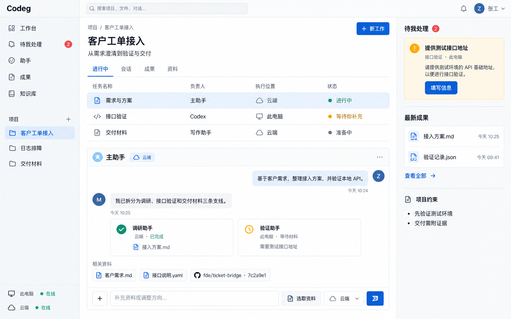
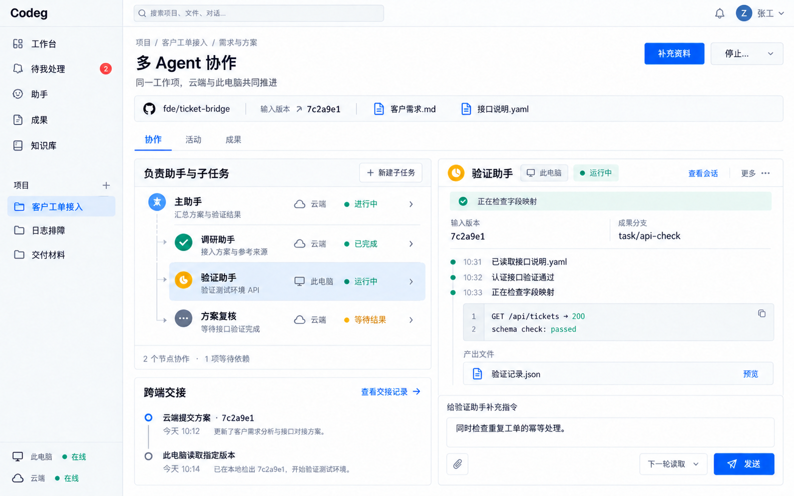
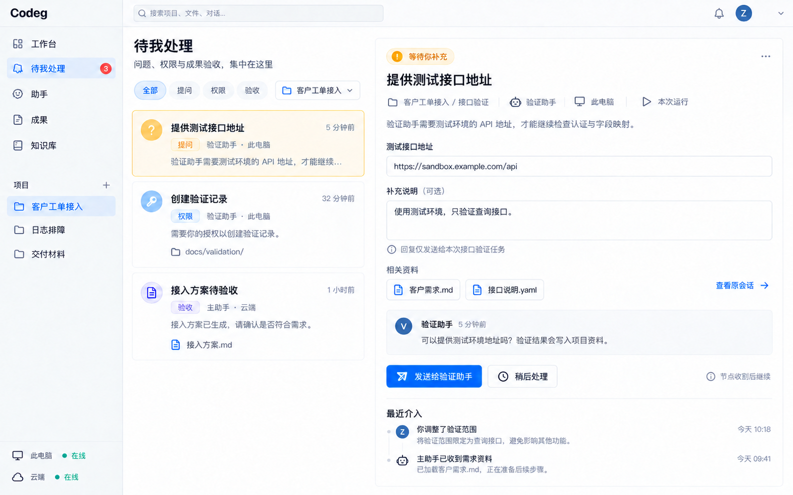
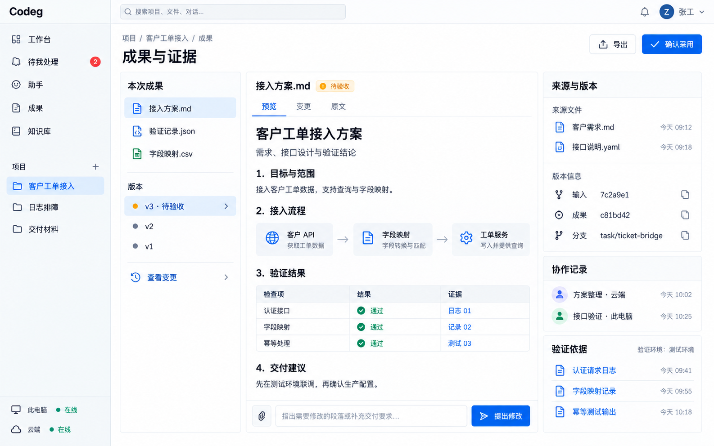

# Codeg 个人多智能体工作台设计稿

2026-10-14，使用内置“创建图像”能力（image_gen）生成。四张同一视觉系统的桌面概念稿，围绕个人 FDE 的云端与客户端协作、人工介入和成果审阅展开。它们用于讨论布局与操作关系，画面中的项目、接口、时间、状态及版本号都是示例。

| 设计稿 | 重点 | 最终图片 |
| --- | --- | --- |
| 项目工作台 | 项目工作、主助手与子任务、资料入口、运行位置、待处理事项 | [01-project-workbench.png](01-project-workbench.png) |
| 多 Agent 协作 | 主子任务关系、节点归属、跨端版本交接、运行过程、给指定子任务补充指令 | [02-multi-agent-collaboration-v2.png](02-multi-agent-collaboration-v2.png) |
| 待我处理 | 将提问、权限、验收集中展示，回复绑定具体助手、节点和本次运行 | [03-human-intervention-v2.png](03-human-intervention-v2.png) |
| 成果与证据 | 文档预览、版本变化、输入与成果 commit、验证依据、提出修改和确认采用 | [04-artifacts-and-evidence.png](04-artifacts-and-evidence.png) |

采用浅色桌面布局、紧凑侧栏、蓝色主动作、青绿色执行状态和琥珀色待处理状态。以“客户工单接入”为示例，把需求、调研、接口验证、方案复核与交付放在同一个项目中。

云端与此电脑标签表示实际执行位置；两端均可担任主助手并组织子代理。示例主助手在云端不构成固定的角色限制。不同画面呈现不同时间点，待处理数量随实际请求变化。

补充指令绑定选中的子任务，并显示“下一轮读取”等送达方式。“停止…”应展开当前执行与整个工作项的停止范围，发送后等待执行节点确认；本稿未展开停止菜单。权限请求只在具体操作需要补充授权时出现。文档“确认采用”表示成果验收，Git 合并、发布与部署各用自己的操作。

这组稿重点展示日常工作状态；离线重连、缺少工具、停止确认和文件同步失败等状态需在后续交互细化时补充。详细产品依据见 [云端与客户端协作建议](../../../work/tasks/codeg-personal-work-prd-review-2026-10-14/cloud-local/proposal.md)。

提示词完整保存在 prompts/：

- [项目工作台](prompts/01-project-workbench.txt)
- [多 Agent 协作](prompts/02-multi-agent-collaboration.txt)及[版本校正](prompts/02-multi-agent-collaboration-revision.txt)
- [待我处理](prompts/03-human-intervention.txt)及[数量校正](prompts/03-human-intervention-revision.txt)
- [成果与证据](prompts/04-artifacts-and-evidence.txt)

02、03 的首次生成稿保留在同目录，最终采用带 v2 后缀的两张。图片均经视觉检查；版本交接号及待处理数量已通过生图编辑校正。原 PRD 与产品代码未改动。

