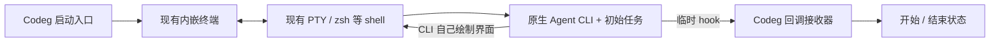

# 内嵌终端启动原生 Agent：简化实现方案

> 状态：首版已实施，待真实 Agent 会话验收。更新：2026-09-30。
> 本文以用户最终确认的“终端嵌入 Codeg、原生 Agent 自行交互、临时 hook 回流事件”为准。

## 1. 目标与职责

Codeg 在自己的界面中打开终端，在终端中运行 zsh 等系统 shell，通过启动命令运行 Codex、Claude Code 等原生 Agent，并携带初始任务与临时 hook 配置。

- **Codeg 负责：** 启动方式配置、打开内嵌终端、下发启动命令、接收 hook、显示开始/结束状态。
- **现有终端组件负责：** PTY、键盘、resize、原始字节传输和终端渲染，继续复用现有实现。
- **原生 Agent 负责：** 命令行界面内容、模型与工具调用、权限交互、任务执行、自己的会话历史。

Terminal 路径不创建 ACP 连接，也不调用 Codeg 内置 Agent。内置 `codeg-agent` 不列为这条路径的启动目标，不需要为 Rig 增加终端或 hook 适配。

**“只关注 hook”指业务接入。** 终端嵌入 Codeg 后仍需要最小的 PTY 输入输出桥接，但 Codeg 不从终端文字推断任务状态，不把 CLI 输出转成聊天消息或工具卡。

zsh 是 shell；Ghostty 是终端应用。本方案使用 Codeg 已有终端视图承载 shell，不启动外部终端窗口，也不把 Ghostty 窗口嵌入 WebView。



## 2. 用户操作与启动流程

启动方式仍放在各智能体配置页，保存 `launch_mode: "acp" | "terminal"`。旧配置默认 `acp`；选中 Terminal 后，首页按此值分流。设置保存本身不启动 Agent，配置读取完成前不能提前连接 ACP。

用户选定 Agent、项目目录并提交初始任务后：

1. 后端生成本次运行的 `run_id`，关联 `terminal_id`、Agent 和项目；准备仅本次启动使用的 hook 配置与回调凭据。
2. 前端创建内嵌终端并先订阅现有 output/exit 事件。
3. 后端调用现有 `TerminalManager::spawn_with_id`：`working_dir` 使用当前项目或工作树，`shell` 使用已支持的系统 shell，`initial_command` 使用该 Agent 的原生命令。
4. 通过原生 CLI 已支持的启动参数，一次性携带初始任务和临时 hook 配置；CLI 自行处理登录、目录信任、权限及交互。
5. 原生 hook 触发时回传 Codeg，更新对应运行的开始/结束状态；用户后续直接在终端中操作 Agent。

启动命令按 Agent 和 shell 生成。可执行文件、临时文件路径和初始任务分别进行正确的参数引用，用户任务作为一个参数，不能原样拼成可执行 shell 代码。保留现有环境变量合并方式，凭据不写进命令字符串。

**不需要新增 PTY `Program` 分支。** 直接复用现有 `initial_command`、`extra_env`、`temp_files`。也不需要“等几秒后向终端输入任务”：支持初始任务参数的 CLI 在启动时接收任务；不支持的 CLI 显示明确能力限制，并保留草稿供用户在终端输入。

Agent 退出后的终端表现沿用现有终端能力；后台组件没有收到结束 hook 时，不能把终端退出自动解释成任务成功。

## 3. 临时 hook 与事件回流

### 3.1 只注入本次运行

每次运行生成独立临时配置，通过 CLI 的会话级配置参数载入：Claude 使用临时 JSON 文件，所核验的 Codex 版本可使用单次 `-c` 配置。需要文件时才落临时文件；不修改项目或用户全局配置，不替换 `HOME` / `CODEX_HOME`，不覆盖用户原有 hooks。

临时文件跟随本次终端登记清理；启动失败、关闭或退出时撤销回调凭据并清理文件。现有 `temp_files` 只删除文件；新增的空临时目录由启动模块负责删除。旧运行的回调不能影响下一次运行。

是否具备临时配置入口、开始 hook、结束 hook，属于各 CLI 的原生能力。适配器只完成参数配置与事件名称映射，不实现 Agent 执行循环。CLI 的 hook 信任确认继续由原生 CLI 处理，不自动跳过。

### 3.2 开始与结束的含义

| Codeg 事件     | 原生来源                | 含义                              |
| -------------- | ----------------------- | --------------------------------- |
| `turn_started` | 例如 `UserPromptSubmit` | 用户向 Agent 提交了本轮任务       |
| `turn_stopped` | 例如 `Stop`             | 原生 Agent 发出了本轮响应停止信号 |

`SessionStart` / `SessionEnd` 是会话生命周期，不能代替每轮任务事件。PTY 创建、进程退出也不能代替这两个业务事件。

**结束 hook 不等于任务验收成功。** 某些 CLI 的其他 Stop hook 可以要求继续执行，因此 Codeg 记录原生事件来源，界面可显示“收到结束事件”，首版不凭这个事件自动启动下一项任务或生成“任务成功”结论。后续若需要可靠的完成调度，再增加对应 CLI 的确认规则。

状态回流只包含本次运行标识、原生事件类型、原生会话/轮次 ID（有则携带）和时间；首版不回传完整提示词、工具参数、终端输出或会话正文。

### 3.3 最小回调通道

采用一个轻量本地 HTTP 接收器，运行在 Codeg 后端，首次使用时监听 `127.0.0.1` 的随机端口。桌面和服务器模式复用同一逻辑；服务器模式中 CLI 与接收器都位于服务器，浏览器只接收 Codeg 的状态事件。

- hook 命令调用当前 Codeg 可执行文件的轻量 `--agent-hook` 入口，读取 CLI 的 hook payload，映射必要字段并发给接收器。沿用已有 `--credential-helper` 的提前退出模式，不启动第二个 GUI 或服务器。
- 回调地址、`run_id` 和独立随机 token 通过本次子进程环境传入；接收器按 token 绑定运行，不能仅相信请求中的 Agent/terminal ID。
- helper 总耗时有短超时上限，接收端限制请求大小；通知失败不阻塞 Agent，不向 CLI 输出控制指令。界面初始显示“尚未收到状态事件”，只按实际回调更新；没有回调时不能区分未信任、未触发或通知失败，不解析终端文字补造原因和事件。
- 接收器更新本次运行的最新状态，再通过现有 `EventEmitter` 发出 `agent-terminal://event`。前端重挂载可查询当前状态，无需持久消息队列。
- 每个回调携带 `event_id` 去重；原生提供 `turn_id` 时用于区分轮次。没有轮次 ID 时仅展示观察到的事件，不宣称具备完整任务顺序。原生子 Agent 事件不改写父 Agent 状态；无法区分来源的适配器不宣称可靠父任务状态。

拟议的最小业务消息如下，接收端根据凭据补充受信任的运行归属：

```ts
type AgentTerminalEvent = {
  run_id: string
  event_id: string
  type: "turn_started" | "turn_stopped"
  native_event: string
  native_session_id?: string
  native_turn_id?: string
  received_at: string
}
```

临时 hook 不提供通用命令执行 API。它只通知 Codeg 本轮开始或收到结束信号。

## 4. Agent 接入范围

首批按实际安装版本核验 Codex 与 Claude Code：原生命令、初始任务参数、会话级 hook 配置和事件名称四项全部通过后，标记为支持完整状态回流。具体官方能力见 [原生 hook 调研补充](terminal-agent-runtime-research.md#8-原生-hook-能力与临时注入)。

Grok 等其他 CLI 使用同样的薄适配方式，但需要先确定具体发行版和版本；不能仅根据 Agent 名称假设它支持某个 hook 参数。没有原生开始/结束 hook 的 CLI 仍可在终端运行，界面明确显示“状态回流不可用”，不承诺完成本方案的全部 hook 能力。

Terminal 的可用性按原生 CLI 判断，不依赖 ACP adapter 是否安装。既有 ACP 配置继续服务 ACP 路径；Terminal 仅传原生 CLI 真正识别的参数与环境。

## 5. 实施改动

| 改动                 | 主要位置                                                                                                                                        | 完成条件                                                                |
| -------------------- | ----------------------------------------------------------------------------------------------------------------------------------------------- | ----------------------------------------------------------------------- |
| 配置与启动分流       | `db/entities/agent_setting.rs`、对应迁移/服务/配置同步；`settings/acp-agent-settings.tsx`、`use-connection-lifecycle.ts`、`available-agents.ts` | 每 Agent 保存启动方式；Terminal 新启动不触发 ACP；原生 CLI 可以独立使用 |
| 原生命令与临时 hooks | 新增 `src-tauri/src/terminal/agent_launch.rs`、`agent_hooks.rs`；接入 `commands/terminal.rs`、`web/handlers/terminal.rs`                        | 生成启动命令、临时配置与运行关联；复用现有 shell/PTY；正确携带初始任务  |
| 回调与状态展示       | `main.rs`、`bin/codeg_server.rs` 的 helper 入口；`app_state.rs`、`lib.rs` 注册；复用 `web/event_bridge.rs`；前端终端标签状态                    | 回调能更新正确运行；重复/过期/错误凭据不改变状态；桌面/Web 共用         |

表内后端既有路径相对 `src-tauri/src/`，前端相对 `src/`。配置字段沿用 `launch_mode`，默认值 `acp`，约束取值为 `acp` / `terminal`；旧配置导入缺少字段时保留已有值，新记录默认 ACP。

最少新增两个面向前端的能力：`terminal_spawn_agent` 接收 Agent、cwd、初始任务及 terminal ID；`terminal_agent_state` 查询对应运行的最新 hook 状态。CLI 命令和 hook token 由后端生成，前端不需要拼接。桌面命令与 Web handler 调用相同核心逻辑。

实施顺序为：配置分流 → 单个 CLI 在内嵌 shell 启动 → 临时 hook 回流 → 第二个 CLI 适配 → 桌面/Web 验收。保存设置只影响后续启动，已有运行实例继续其原方式。

## 6. 验收与范围

- 选择 Terminal 后，Agent 界面出现在 Codeg 内；ACP connect/prompt 和内置 Agent 调用均为零。
- 项目路径含空格、任务含中文/引号/换行时，CLI 收到正确目录和完整任务，不执行任务正文中的 shell 语法。
- 连续提交两轮任务能收到对应原生开始/停止事件；用户 hooks 保持生效；多终端事件不串线；子 Agent 的停止事件不误结束父任务。
- hook 未被原生 CLI 信任、配置不支持或回调失败时，终端仍按原生能力交互；已知不支持的显示不可用，没有回调的显示尚未收到事件，不误报成功。
- 刷新视图仅重接已有终端，不再次下发启动命令/初始任务；重复启动请求不会运行两份任务。
- 启动失败、正常退出及关闭清理临时文件与凭据；hook 结束与 PTY 退出分别处理。
- 复用终端时验证中文/emoji 跨读取块、快速退出错误和基本键盘/resize。现有按块 `from_utf8_lossy` 的编码风险应作小范围修正，不扩展成终端框架重写。

首版已按此方案接入 Agent 配置、内嵌终端启动、临时 hook 回调和最新状态查询。Codex 通过本机 CLI 的 `doctor --json` 无任务探针确认临时 hook 配置可加载；Claude Code 以 `1.0.54` 为开始/停止 command hook 的最低版本。Grok 可接收位置参数启动任务，当前没有逐轮状态回流。Windows 目前可通过 PowerShell 启动原生 CLI，临时 hook 回流暂不可用。Terminal 首条任务只接受纯文本；非文本附件会提示并保留草稿。

本轮验证覆盖 Rust 单元/PTY 测试、前端分流测试及本机 Codex 无任务配置探针；尚未以真实 Codex 或 Claude 会话验证逐轮回调。已有 [终端调研](terminal-agent-runtime-research.md) 保留开源证据；独立 daemon、终端传输重构、屏幕完整持久化、工具卡和跨 Agent 自动化不在本次实现范围内。
