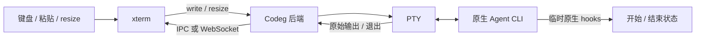

# Terminal Agent：事件订阅与 PTY 支持难度调研

调研日期：2026-09-30。范围：Codeg 现有实现、三款开源 Agent 工作台的固定版本源码，以及 Tauri / xterm 官方文档。没有运行参考项目、真实 Agent 或性能基准。

> 方案已按用户后续要求收敛为：Codeg 内嵌终端运行 shell 和原生 CLI，启动时下发初始任务，业务层只接临时 hook。当前实施范围以 [简化方案](terminal-agent-launch.md) 为准；以下开源源码观察保留作证据。

## 1. 判断

**基于 Codeg 当前基础，让原生 Agent CLI 在内嵌终端运行，难度中低；做到网络断开、视图重挂载、高频输出和跨平台关闭都可靠，难度中等偏高。** 当前不需要重新实现 PTY 或终端模拟器。

“订阅事件”要区分两件事：

| 层次           | 事件/数据                                    | 来源                                   | 实现难度                               |
| -------------- | -------------------------------------------- | -------------------------------------- | -------------------------------------- |
| 终端输入输出   | 字符、颜色、光标控制、键盘输入、窗口大小     | PTY 字节流与终端模拟器                 | 低至中，Codeg 已有主体                 |
| 进程生命周期   | 已启动、运行中、退出码、启动失败             | 宿主进程管理                           | 中，需要处理在途启动、取消和子进程清理 |
| Agent 任务状态 | 等待审批、当前任务完成、工具调用、token 使用 | CLI 原生 hooks / 结构化日志 / 专用协议 | 中高至高，需要按 Agent 适配            |

Codeg 已有前两层的主要实现。本次用户还明确要求第三层中的开始/结束事件，因此临时 hook 纳入首版；工具调用、token 统计与完整任务调度不随之扩展。进程退出不等于任务成功，输出沉默也不等于完成。



CLI 不需要向 Codeg 提供 ACP 或“输出订阅 API”。Codeg 读取自己创建的 PTY，再通过自己的事件通道把数据送到界面。

## 2. 样本与版本

选择工作台/宿主项目，是因为它们与本次需求同样负责运行现成 CLI；单个 Agent 内部执行工具命令的终端实现不是完全相同的问题。

| 项目                                                                                              | 固定版本及提交时间（UTC）           | 与 Codeg 的相关性                                     |
| ------------------------------------------------------------------------------------------------- | ----------------------------------- | ----------------------------------------------------- |
| [Schaltwerk](https://github.com/2mawi2/schaltwerk/tree/5e13063057de9d1d41d3717d7e363594159e10a3)  | `5e13063057de`，2026-09-29 04:22:27 | Tauri + Rust portable-pty + xterm，技术栈接近         |
| [Emdash](https://github.com/generalaction/emdash/tree/873a3e2067f4abc136272ed2b61abea3a2c07bcf)   | `873a3e2067f4`，2026-09-27 08:37:38 | 同时提供独立 TUI 和 ACP runtime，适合参考启动方式分流 |
| [Superset](https://github.com/superset-sh/superset/tree/555b711afd2017887afa393e35096f1cb25e9ac7) | `555b711afd20`，2026-09-30 02:25:21 | 独立 PTY daemon，适合参考长期运行、回放和流控         |

抓取时间为调研当天；上述时间是提交时间，不代表发布或稳定版时间。以下描述是指定版本的实现事实，不是经过本次运行验证的产品保证。

## 3. 开源实现怎样解决这些问题

### 3.1 Schaltwerk：同栈的直接参考

启动流程是：Agent 启动描述 → 按 terminal ID 加锁 → 解析 cwd、command、args、env → TerminalManager → LocalPtyAdapter → portable-pty。内部用 `CommandSpec { program, args, env, env_remove }`；解析到程序路径时逐项传 argv，解析不到时另有 login-shell fallback。[启动入口](https://github.com/2mawi2/schaltwerk/blob/5e13063057de9d1d41d3717d7e363594159e10a3/src-tauri/src/commands/schaltwerk_core/agent_launcher.rs#L40)、[命令描述](https://github.com/2mawi2/schaltwerk/blob/5e13063057de9d1d41d3717d7e363594159e10a3/src-tauri/src/domains/terminal/command_builder.rs#L11)。

它专门处理两个容易遗漏的细节：流式 UTF-8 解码保留跨块多字节尾部；前端 registry 区分 detach（移走视图）和 release（销毁实例），同时为 TUI 输出安排队列和渲染调度。[UTF-8 解码](https://github.com/2mawi2/schaltwerk/blob/5e13063057de9d1d41d3717d7e363594159e10a3/src-tauri/src/domains/terminal/utf8_stream.rs#L15)、[终端 registry](https://github.com/2mawi2/schaltwerk/blob/5e13063057de9d1d41d3717d7e363594159e10a3/src/terminal/registry/terminalRegistry.ts#L163)。

仓库另有带 ACK、高低水位暂停读取的 PTY host，但该 transport 由环境变量显式启用，不能描述为所有默认 Agent 终端都使用了它。它的前端 ACK 发生在解码/分发之后，也不能当成“xterm 已渲染完毕”的严格消费回执。[可选开关](https://github.com/2mawi2/schaltwerk/blob/5e13063057de9d1d41d3717d7e363594159e10a3/src/terminal/transport/transportFlags.ts#L10)、[PTY 水位控制](https://github.com/2mawi2/schaltwerk/blob/5e13063057de9d1d41d3717d7e363594159e10a3/src-tauri/crates/pty_host/src/host.rs#L174)、[ACK 位置](https://github.com/2mawi2/schaltwerk/blob/5e13063057de9d1d41d3717d7e363594159e10a3/src/terminal/stream/terminalOutputManager.ts#L185)。

**Codeg 适合借鉴：** 结构化程序/参数、流式解码、视图与运行实例分离。不要照搬“启动入口发现旧终端就关闭重建”的产品策略；Codeg 的恢复场景应接回原进程。其 idle 检测基于字节和屏幕变化，属于活动推断，不能替代任务完成事件。[idle 实现](https://github.com/2mawi2/schaltwerk/blob/5e13063057de9d1d41d3717d7e363594159e10a3/src-tauri/src/domains/terminal/idle_detection.rs#L6)。

### 3.2 Emdash：ACP 与 Terminal 分流最贴近本需求

它将 TUI 与 ACP 作为两个 runtime；共享 Agent 插件中的身份和配置能力，但 TUI 调用 `buildPromptCommand`，ACP 调用 `buildAcpSpawn`。Codex/Claude 分别有原生 CLI 配方和 ACP 适配器配方。[插件入口](https://github.com/generalaction/emdash/blob/873a3e2067f4abc136272ed2b61abea3a2c07bcf/packages/core/src/services/agent-plugins/api/plugins/plugin-host.ts#L148)、[Codex 配方](https://github.com/generalaction/emdash/blob/873a3e2067f4abc136272ed2b61abea3a2c07bcf/packages/plugins/src/agents/impl/codex/index.ts#L135)。

TUI runtime 接收 command + argv，生成本地 PTY invocation；底层 `node-pty` 负责终端进程。对上提供 write/resize RPC，以及三条独立数据流：PTY output、进程 sessions、Agent states。不是把原始终端输出解析成 ACP 消息。[PTY 启动组装](https://github.com/generalaction/emdash/blob/873a3e2067f4abc136272ed2b61abea3a2c07bcf/packages/core/src/runtimes/tui-agents/node/runtime/runtime.ts#L940)、[runtime 合同](https://github.com/generalaction/emdash/blob/873a3e2067f4abc136272ed2b61abea3a2c07bcf/packages/core/src/runtimes/tui-agents/api/contract.ts#L75)。

输出使用 retained live log，默认上限 1 MiB，带 generation、sequence、baseOffset、truncated。客户端按游标补后缀，不能补齐时 reset；这些是有界原始输出，不能视为完整 TUI 屏幕快照。[日志源](https://github.com/generalaction/emdash/blob/873a3e2067f4abc136272ed2b61abea3a2c07bcf/packages/wire/src/live/log/source.ts#L5)、[重同步客户端](https://github.com/generalaction/emdash/blob/873a3e2067f4abc136272ed2b61abea3a2c07bcf/packages/wire/src/live/log/client.ts#L25)。

Agent 状态主要来自 provider hook：start → working，stop → completed，特定 notification → awaiting-input。hook server 不可用时仍可启动 CLI；缺少 start hook 时，回车/初始 prompt 只标记 working。这层适配不会因为“PTY 没输出”就自动得到 completed。[状态映射](https://github.com/generalaction/emdash/blob/873a3e2067f4abc136272ed2b61abea3a2c07bcf/packages/core/src/runtimes/tui-agents/node/runtime/agent-state.ts#L45)、[hook 接线与降级](https://github.com/generalaction/emdash/blob/873a3e2067f4abc136272ed2b61abea3a2c07bcf/packages/core/src/runtimes/tui-agents/node/runtime/runtime.ts#L803)。这里的 completed 表示 hook 报告的回合结束，并不证明用户目标或产物验收已通过。

**Codeg 适合借鉴：** 两条启动配方、三层状态、游标回放，以及按 Agent 声明 hooks/初始 prompt 能力。源码还包含异常退出自动重启、resume 失败退回新会话等策略；这些不适合直接带入本次方案，Codeg 应继续禁止静默重放用户任务。

### 3.3 Superset：持续运行是单独一层工程

当前 v2 实现用独立 `pty-daemon` 持有 PTY，host-service 通过 Unix socket 成为客户端；因此宿主服务升级与 PTY 的生命周期分离。仓库还实现了 daemon 升级时的文件描述符交接。这属于长期运行架构，不是一般“打开终端”必需的组成。[daemon 说明](https://github.com/superset-sh/superset/blob/555b711afd2017887afa393e35096f1cb25e9ac7/packages/pty-daemon/README.md)。

daemon 的 SessionStore 保存有界内存 ring buffer，默认 64 KiB，供 host 重新订阅时回放。它明确不将此缓冲写到磁盘。因此应区分“UI/host-service 重启但 daemon 仍在”和“daemon 或机器已经终止”；后者不能靠内存缓冲恢复运行。[SessionStore](https://github.com/superset-sh/superset/blob/555b711afd2017887afa393e35096f1cb25e9ac7/packages/pty-daemon/src/SessionStore/SessionStore.ts#L6)。

daemon 根据订阅 socket 的 `writableLength` 暂停 PTY，收到 drain 后恢复；长期不读取的连接会被断开，避免一个坏订阅者拖住全部生产者。这个机制保证的是 daemon 到订阅 socket 的背压，不能仅据此断言浏览器 xterm 已经消费完毕。[输出与阻塞处理](https://github.com/superset-sh/superset/blob/555b711afd2017887afa393e35096f1cb25e9ac7/packages/pty-daemon/src/Server/Server.ts#L559)。

host-service 另保留 2 MiB 输出缓冲，以 epoch 与字节序号为浏览器补缺失片段；超出缓冲、epoch 变化或跨尺寸变化时，重新确定同步位置并请求程序重绘。浏览器还有 xterm 序列化存储，host 有 headless 屏幕读取。这些分别解决输出追赶和画面恢复，不等同于原进程持久化。[同步逻辑](https://github.com/superset-sh/superset/blob/555b711afd2017887afa393e35096f1cb25e9ac7/packages/host-service/src/terminal/terminal.ts#L1982)、[屏幕读取](https://github.com/superset-sh/superset/blob/555b711afd2017887afa393e35096f1cb25e9ac7/packages/host-service/src/terminal/terminal.ts#L1317)。host→浏览器链路则在发送积压过大时断开慢客户端，让它重连补数据；没有直接复制 daemon 的暂停策略。[慢客户端处理](https://github.com/superset-sh/superset/blob/555b711afd2017887afa393e35096f1cb25e9ac7/packages/host-service/src/terminal/terminal.ts#L1888)。

进程清理由专门的 TreeKiller 处理：除根进程外还追踪进程组/后代，支持信号升级与复查。这说明多 Agent 的可靠退出确实需要验证，不能仅看调用了一个 kill 方法。[TreeKiller](https://github.com/superset-sh/superset/blob/555b711afd2017887afa393e35096f1cb25e9ac7/packages/pty-daemon/src/Pty/Pty.ts#L60)。

**Codeg 适合借鉴：** 运行所有权、慢消费者清理、显式 attach/close 的边界。首版继续由 Codeg 后端进程持有 PTY；除非明确要求“桌面应用退出后 Agent 继续跑”，不引入独立 daemon、Unix socket 或描述符迁移。

## 4. Codeg 已有什么，还缺什么

| 项目                 | 当前证据                                                                               | 增量工作 / 难度                                                       |
| -------------------- | -------------------------------------------------------------------------------------- | --------------------------------------------------------------------- |
| 创建真实 PTY         | [manager.rs](../../src-tauri/src/terminal/manager.rs)，`spawn_with_id`                 | 已有 portable-pty；复用 shell + initial_command，低                   |
| output/exit 订阅     | [terminal-view.tsx](../../src/components/terminal/terminal-view.tsx)，spawn 前注册监听 | 已有；保持顺序并接新启动接口，低                                      |
| 输入、resize         | `TerminalView`、[write-queue.ts](../../src/lib/terminal/write-queue.ts)                | 已有输入串行/合批、resize；做 TUI 键盘与尺寸回归，低至中              |
| 智能体模式分流       | [use-connection-lifecycle.ts](../../src/hooks/use-connection-lifecycle.ts)             | 读取持久化配置后再允许预连接，后端再次守卫，中                        |
| 输出回放             | `TerminalSnapshot`、scrollback、seq floor                                              | 已有基础；接回实例、识别过期 ID、禁止自动重启，中                     |
| 中文/emoji 编码      | `read_loop` 每块独立 `from_utf8_lossy`                                                 | 存在跨块替换字符风险；加流式解码和边界测试，范围小但应优先            |
| Web 重连/丢帧恢复    | [ws.rs](../../src-tauri/src/web/ws.rs) 使用全局广播，lag 会跳过事件                    | TerminalView 未自动修复所有缺口；重连和 seq gap 两种触发都要覆盖，中  |
| 高频输出流控         | 当前输出回调直接 `term.write`，没有终端专用渲染消费 ACK                                | 先测单/多终端负载；批量发送较易，端到端背压需要协议和消费计量，中至高 |
| 视图/进程生命周期    | [terminal-context.tsx](../../src/contexts/terminal-context.tsx) Provider 卸载会 kill   | 对 Agent 终端区分 detach/close/退出，中                               |
| 进程树退出           | `terminate_terminal` 显式 child.kill/wait                                              | 需要按平台验证与补齐，中                                              |
| 宿主重启后进程仍运行 | PTY 当前归 Codeg 进程所有                                                              | 需另建持久宿主，属于较大工程，非首版必需                              |
| Agent 业务事件       | ACP 已有，但原生 PTY 不自动产生同等事件                                                | 先做逐 Agent 临时开始/结束 hooks；中，按版本核验                      |

Codeg 当前先订阅、再取快照并按 seq 去重的处理值得保留。不能为了“参考开源实现”退化为先 snapshot 后 listen，重新引入两步之间的输出遗漏。

## 5. 当前方案取舍

用户最终确认终端嵌在 Codeg 内，但 CLI 的界面内容与交互由原生 Agent 负责，Codeg 业务层只接 hook。相应取舍如下：

1. 复用现有 shell、PTY、xterm 和输出事件，不新增 PTY Program 分支，不嵌入 Ghostty 外部应用窗口。
2. 启动方式按 Agent 保存，配置加载后再决定 ACP 或 Terminal；Terminal 下发原生 CLI 命令、初始任务和临时 hook 配置。
3. 临时 hook 的开始/停止事件成为首版内容；不从 ANSI 文本或空闲时间推断任务成功。
4. 恢复仅重接现有终端，不重复下发任务。独立 daemon、全套业务事件、屏幕完整持久化与终端传输重构移出本次实施范围。

Emdash 的“原生 hooks 与终端输出分开”和 Superset 的“shell 中启动命令”最贴近此次边界。Schaltwerk 提供同栈参考，但不需要为本次功能引入它的全部终端层。

Tauri 官方建议高吞吐流式数据使用 Channel，xterm 官方建议按消费进度控制生产速度。这些结论保留作为现有终端遇到实际瓶颈时的改进依据，不是此次 hook 接入的前置重构要求。[Tauri 官方文档](https://v2.tauri.app/zh-cn/develop/calling-frontend/)、[xterm 官方流控文档](https://xtermjs.org/docs/guides/flowcontrol/)。

## 6. 收敛后的难度

| 工作                          | 判断         | 原因                                                      |
| ----------------------------- | ------------ | --------------------------------------------------------- |
| 内嵌终端启动 shell / 原生 CLI | 低           | Codeg 已有 initial_command、环境和终端视图                |
| 下发初始任务                  | 低至中       | CLI 有位置参数时较直接；仍需验证引用、长文本与 shell 差异 |
| 临时 hook 回调接收与 UI 状态  | 低至中       | 少量事件，复用 EventEmitter，无需终端输出解析             |
| 不同 Agent 的临时 hook 注入   | 中，主要变量 | 原生版本、配置合并、信任与事件含义不同                    |
| 没有开始/停止 hook 的 CLI     | 能力限制     | 不能通过普通 shell wrapper 伪造每轮 Agent 事件            |

总体是复用现有终端并增加少量启动和回调代码；新增工作重点在各 CLI 的 hook 接入。此前对完整重连、高负载、跨平台进程树和 daemon 的较大估算不再代表本次范围。具体工期应在首个 CLI 的临时配置与回调验证后估算，本次没有运行性能或实际接入测试。

## 7. 核心验收

- Terminal 路径内原生 Agent 正常显示和交互，初始任务正确传入，ACP 调用为零。
- 用户原有配置/hooks 保持生效；临时注入只属于本次运行。
- 多轮开始/停止、多实例隔离、子 Agent 事件和无回调情况各自可辨认。
- Stop 信号不自动等价为任务成功；不因 PTY 退出补造完成事件。
- 重挂载不重复运行 CLI，不重复提交任务；退出后临时资源能清理。

完整浏览/下载证据和子任务结果保存在被忽略的 `work/tasks/terminal-agent-launch-plan/research/`。本报告没有把上游代码或测试文件的存在表述为本次实际运行成功。

## 8. 原生 hook 能力与临时注入

2026-09-30 补充核验官方文档及源码。Claude 文档为滚动文档，同期 release 为 `v2.1.285`；Codex 固定到 `rust-v0.159.2` 的提交 `8c3612fb638d356579c446de68421288164484dc`。这不是两者的最低支持版本；目标机器上的旧版本需要单独检测。

| CLI         | 开始 / 停止事件             | 单次注入                               | 初始任务                    |
| ----------- | --------------------------- | -------------------------------------- | --------------------------- |
| Claude Code | `UserPromptSubmit` / `Stop` | `--settings <临时 JSON>`               | 交互命令的位置参数          |
| Codex       | `UserPromptSubmit` / `Stop` | 重复 `-c 'hooks.<Event>=…'`，值为 TOML | 交互命令的位置参数 `PROMPT` |

Claude 的 hooks 在配置层之间追加；保留默认配置来源即可继续加载用户 hooks。`Stop` 可以被其他 hook 的阻止决定变成继续执行，API 错误与用户中断也不保证发送同样的 Stop。因此开始/停止用于观察原生事件，不能当作完整成功判定。[Claude hook 文档](https://code.claude.com/docs/en/hooks)、[CLI 参数](https://code.claude.com/docs/en/cli-reference)。

Codex 固定源码已包含 `UserPromptSubmit`、`Stop`、`Interrupt` 等 lifecycle hooks；不再只有旧 `notify` 完成通知。其配置层逐层收集 hooks，单次覆盖值通过 TOML 解析，适合只叠加 Codeg 的通知项。[事件配置 schema](https://github.com/openai/codex/blob/8c3612fb638d356579c446de68421288164484dc/codex-rs/config/src/hook_config.rs#L35)、[命令行配置解析](https://github.com/openai/codex/blob/8c3612fb638d356579c446de68421288164484dc/codex-rs/utils/cli/src/config_override.rs#L16)、[逐层加载](https://github.com/openai/codex/blob/8c3612fb638d356579c446de68421288164484dc/codex-rs/hooks/src/engine/discovery.rs#L118)。

以 POSIX shell 为例，下面表示配置形态；helper 路径在实现时应独立引用，前端不直接拼接该字符串。示例使用的 `--agent-hook` 是本方案拟新增的 Codeg 入口。

```text
claude --settings '/临时目录/hooks.json' '初始任务'

codex \
  -c 'hooks.UserPromptSubmit=[{hooks=[{type="command",command="/absolute/path/codeg --agent-hook turn-start"}]}]' \
  -c 'hooks.Stop=[{hooks=[{type="command",command="/absolute/path/codeg --agent-hook turn-stop"}]}]' \
  '初始任务'
```

Claude 临时 JSON 的最小形态：

```json
{
  "hooks": {
    "UserPromptSubmit": [
      {
        "hooks": [
          {
            "type": "command",
            "command": "/absolute/path/codeg --agent-hook turn-start"
          }
        ]
      }
    ],
    "Stop": [
      {
        "hooks": [
          {
            "type": "command",
            "command": "/absolute/path/codeg --agent-hook turn-stop"
          }
        ]
      }
    ]
  }
}
```

保留原生的 hook 信任与管理策略；helper 只读 stdin、发通知，成功退出且不输出决策，不强制继续或停止 Agent。尚未收到回调时只显示未知状态，不能识别为已经执行或已经完成。开始 hook 也可能随后被其他用户 hook 拒绝，不能据此断言模型已经开始生成。

本次只进行了文档和固定源码核验，没有运行上述 CLI 命令。实施时需要在目标安装版本验证临时配置解析、原有 hooks 共存、信任确认、首条任务和连续两轮事件。Grok 的具体 CLI 发行版未确定，本次没有声称它具备相同 hooks。
